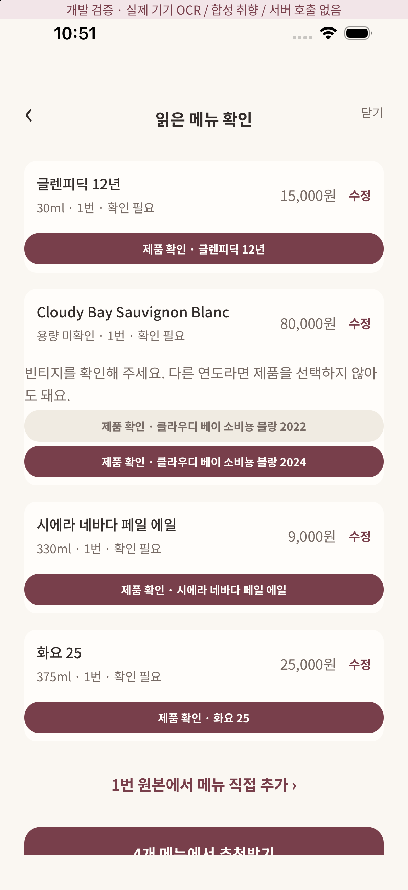
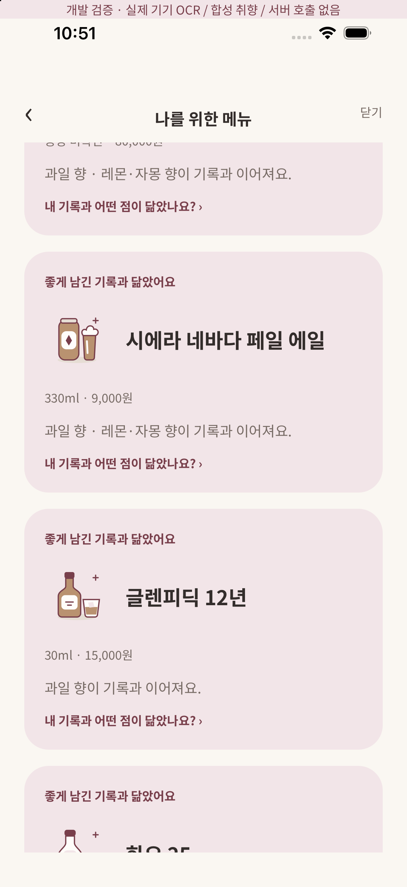

# 출처 기반 추천 카탈로그

번들/구버전: 2026-10-23.1, 조회일2026-10-23, 32개 판본(각8개). 공통DB 최신 상태는2026-10-30 추가4개를 적용한36개(위스키10·맥주10·와인8·전통주8)다. [제조사 검토 추가 묶음과 실제 검증](verification/catalog-expansion/README.md). 빈티지는 별도 제품으로 센다. 제조사 설명 31개와 독립 심사기관 IWSC의 직접 심사 1개를 사용한다. 전 세계 제품 DB나 실시간 재고·가격 정보가 아니다.

## 식별과 추천 계약

- 한글·영문 표기, 공백·구두점·악센트·전각 문자를 정규화하되 숫자 사이 소수점은 보존하고 등록한 전체 별칭만 후보로 사용한다. OCR이 일부를 놓치면 사용자 수정 후 다시 확인한다.
- 빈티지 없는 클라우디 베이 소비뇽 블랑은 2022/2024 후보를 각각 보여준다. 실제 연도를 사용자가 확인해야 한다. 2023을 2022로 대체하지 않는다. 다른 와인도 출처가 확인된 연도만 지원한다. NV 샴페인에 임의 연도를 붙인 경우 미확인으로 둔다.
- 도수·숙성연수·숙성판·레시피가 다른 제품은 같은 것으로 확정하지 않는다. 펑크 IPA는 새 5.4% 판본만 지원한다.
- 확정 제품 ID도 메뉴 이름의 후보 집합에 속하는지 서버에서 다시 검사한다. 다른 술 ID를 끼워 넣으면 INVALID_ITEM이다.
- 각 특징은 기존 v2 질문에서 발생하는 feature ID에 연결하고 출처 설명을 보관한다. 향의 달콤함을 맛의 당도로, 부드러운 질감을 낮은 알코올 자극으로 바꾸지 않는다. 원료만 보고 향을 추정하지 않는다.
- 같은 근거 기록의 같은 차원(예: 향)은 동의어가 여러 개 맞아도 점수를 한 번만 준다. 반대 평가도 따로 보존한다. 근거 목록에는 원래 fact ID를 유지한다.
- 지원 제품이어도 사용자 기록에 대응하는 특징이 없으면 취향이 비슷하다고 주장하지 않는다. 사진만 남긴 기록은 취향 근거가 아니다.
- 앱/서버가 동일한 product-catalog.ts를 사용한다. 서버 응답에 catalogVersion/catalogSize를 포함한다.

## 제품별 범위

| 주종 | 제품 | 적용 판본 | 출처 |
| --- | --- | --- | --- |
| whisky | 글렌리벳 12년 | 12년 | [The Glenlivet · 12 Year Old](https://www.theglenlivet.com/en-us/product/12-year-old-single-malt-scotch/) |
| whisky | 메이커스 마크 | 오리지널 | [Maker’s Mark · Original](https://www.makersmark.com/en-us/bourbons/makers-mark) |
| whisky | 글렌피딕 12년 | 12년 · 40% | [Glenfiddich · 12 Year Old](https://shop.us.glenfiddich.com/products/glenfiddich-12-year-old) |
| whisky | 라프로익 10년 | 10년 · 기본판 | [Laphroaig · 10 Year Old](https://www.laphroaig.com/whiskies/10-year-old) |
| whisky | 아드벡 10년 | 10년 · 기본판 | [Ardbeg · Ten Years Old](https://www.ardbeg.com/en-gb/products/ardbeg-ten-years-old) |
| whisky | 조니워커 블랙 라벨 12년 | 블랙 라벨 · 12년 | [Johnnie Walker · Black Label](https://www.johnniewalker.com/en/our-whisky/core-range/johnnie-walker-black-label) |
| whisky | 제임슨 오리지널 | 오리지널 | [Jameson · Irish Whiskey](https://www.jamesonwhiskey.com/en-us/our-whiskey/jameson-irish-whiskey) |
| whisky | 발베니 더블우드 12년 | 더블우드 · 12년 | [IWSC · The Balvenie DoubleWood 12 YO](https://www.iwsc.net/results/detail/89543/the-balvenie-doublewood-12-yo-single-malt-scotch-whisky) |
| beer | 기네스 드래프트 | Draught · 기본판 | [Diageo Bar Academy · Guinness Draught](https://www.diageobaracademy.com/en-us/home/our-brands/guinness-draught) |
| beer | 바이엔슈테판 헤페바이스비어 | 헤페바이스비어 · 5.4% | [Weihenstephan · Hefeweissbier](https://www.weihenstephaner.de/unsere-biere/hefeweissbier) |
| beer | 파울라너 헤페 바이스비어 | 바이스비어 · 기본판 | [Paulaner · Weissbier](https://www.paulaner.com/our-products/weissbier) |
| beer | 호가든 화이트 | White · 기본판 | [Hoegaarden · White](https://www.hoegaarden.com/beer) |
| beer | 필스너 우르켈 | 오리지널 | [Pilsner Urquell · Original](https://www.pilsnerurquell.com/?l=hungarian) |
| beer | 하이네켄 오리지널 | Original · 기본판 | [Heineken · Silver 소개 내 Original 향 설명](https://www.heineken.com/za/en/our-products/heineken-silver/) |
| beer | 시에라 네바다 페일 에일 | Pale Ale · 5.6% | [Sierra Nevada · Pale Ale](https://sierranevada.com/brews/pale-ale) |
| beer | 브루독 펑크 IPA 5.4% | 새 레시피 · 5.4% | [BrewDog · Introducing the new Punk IPA](https://brewdog.com/blogs/news/introducing-the-new-punk-ipa) |
| wine | 클라우디 베이 소비뇽 블랑 2022 | 2022 | [Cloudy Bay · Sauvignon Blanc 2022](https://www.cloudybay.com/en-us/our-wines/sauvignon-blanc/sauvignon-blanc-2022/) |
| wine | 클라우디 베이 소비뇽 블랑 2024 | 2024 | [Cloudy Bay · Sauvignon Blanc 2024 tasting notes](https://www.cloudybay.com/drupal/sites/default/files/2025-04/CloudyBay-TastingNotes-SauvignonBlanc-2024.pdf) |
| wine | 클라우디 베이 샤르도네 2023 | 2023 | [Cloudy Bay · Chardonnay 2023](https://www.cloudybay.com/en-us/our-wines/chardonnay/chardonnay-2023/) |
| wine | 클라우디 베이 피노 누아 2022 | 2022 | [Cloudy Bay · Pinot Noir 2022](https://www.cloudybay.com/en-nz/our-wines/pinot-noir/pinot-noir-2022/) |
| wine | 클라우디 베이 테 코코 2021 | 2021 | [Cloudy Bay · Te Koko 2021](https://www.cloudybay.com/en-ww/our-wines/te-koko/te-koko-2021/) |
| wine | 클라우디 베이 펠로루스 로제 NV | NV · 로제 | [Cloudy Bay · Pelorus Rosé tasting notes](https://www.cloudybay.com/drupal/sites/default/files/2023-11/Violetas-Selection_Tasting-Notes_0.pdf) |
| wine | 모엣 샹동 임페리얼 브뤼 NV | NV · Brut Impérial | [Moët & Chandon · Moët Impérial](https://www.moet.com/en-us/moet-imperial) |
| wine | 뵈브 클리코 옐로 라벨 브뤼 NV | NV · Yellow Label Brut | [Veuve Clicquot · Yellow Label Brut](https://www.veuveclicquot.com/en-us/veuve-clicquot-yellow-label-brut-champagne-11003681.html) |
| traditional | 나루 생막걸리 6도 | 생막걸리 · 6% | [한강주조 · 제품 소개](https://www.hangangbrewery.com/INTRO) |
| traditional | 나루 막걸리 11.5도 | 11.5% | [한강주조 · 제품 소개](https://www.hangangbrewery.com/INTRO) |
| traditional | 글림 약주 | 약주 | [한강주조 · 제품 소개](https://www.hangangbrewery.com/INTRO) |
| traditional | 화요 25 | 25% | [화요 · 제품 소개](https://hwayo.com/home/) |
| traditional | 화요 41 | 41% | [화요 · 제품 소개](https://hwayo.com/home/) |
| traditional | 화요 53 | 53% | [화요 · 제품 소개](https://hwayo.com/home/) |
| traditional | 화요 XP | XP · 오크 숙성 | [화요 · 제품 소개](https://hwayo.com/home/) |
| traditional | 복순도가 손막걸리 | 손막걸리 · 기본판 | [복순도가 · 손막걸리 소개](https://www.boksoon.com/shopinfo/about.html) |

## 검증 및 반영 상태

- 32개 제품의 출처·별칭 충돌·판본, 실제 질문 feature ID 유효성, 4주종 기록 기반 추천, 잘못 연결한 ID 차단을 도메인 테스트한다.
- 실제 Supabase HTTP 통합 테스트에 와인·맥주·전통주 노트 저장 후 추천과 잘못된 제품 ID 거부를 추가했다. CI 결과는 PR을 참조한다.
- 개발 전용 dev/menu?catalog=1: 합성 4주종 메뉴 PNG를 실제 iOS Vision에 넣고 합성 취향과 비교한다. 서버 호출은 하지 않는다.
- 2026-10-30 관리형 개발 DB를 실제 조회해 verified36개(위스키10·맥주10·와인8·전통주8)를 확인했다. menu-recommend/next-drinks도 최신 동적 카탈로그·Gemini 선택 경로로 배포하고 합성 인증 계정으로 검증했다. [메뉴판 선택](verification/menu-selection/README.md), [주간 선택](verification/weekly-generation/README.md). 주종별30개 목표는 아직 미충족이다.
- Android 네이티브 OCR 추가 런타임 검증 및 실제 소셜 로그인 → 관리형 서버 추천 검증은 아직 남아 있다.
- 빈티지 복수 후보 칩은 기존 ChoiceChip을 재사용한 신규 상태다. Figma 원본에서 이 상태의 디자인 일치를 검증했다고 주장하지 않는다.

### 이번 확장 iOS 확인

iPhone 17 Pro / iOS 26.5에서 합성 메뉴 4개를 Vision으로 읽고 제품 칩 4개(와인 2024 선택)를 확인한 뒤 4개 모두 실제 질문 코드 기반 추천 결과와 연결됨을 확인했다. 합성 취향/서버 미호출 배너가 표시된다. 관리형 서버나 실사용자 기록의 검증을 대신하지 않는다.

로컬 npm run check: 87개 중 84 통과, HTTP 환경이 필요한 3개 명시적 skip. Deno 타입 검사 및 양 플랫폼 export 통과 여부는 PR 최종 검증 결과를 참조한다.
