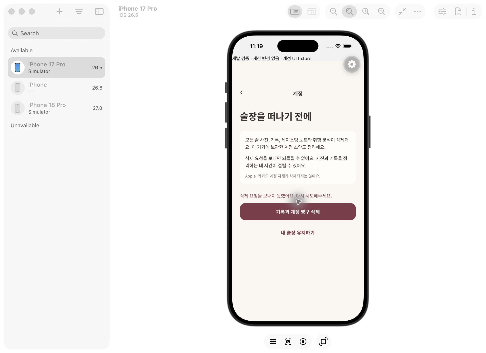
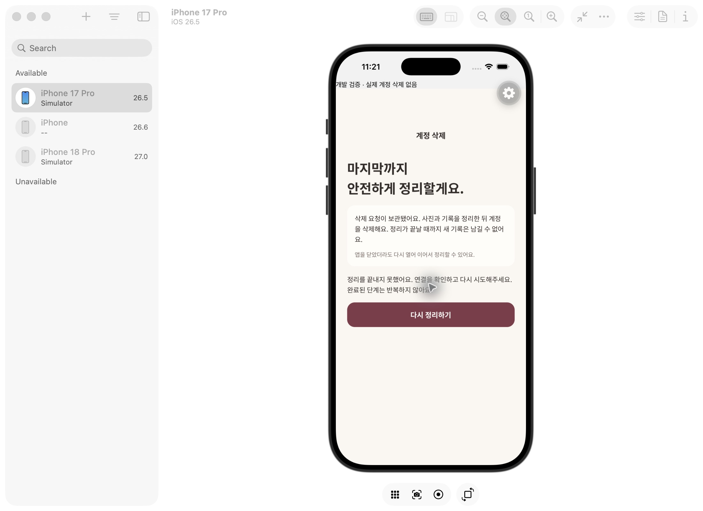

# 계정 삭제 · 구현과 검증

계정 관리에서 별도의 영구 삭제 확인을 거친다. 로그아웃과 구분하고, 서버의 사진·기록·노트·취향 자료 및 Auth 사용자를 정리한다. Apple·카카오 계정 자체를 삭제하는 동작은 아니다.

## 삭제 순서와 복구

1. 검증된 bearer의 Auth 사용자만 대상으로 삼는다. body는 `{confirm:true}`만 허용하며 사용자 ID를 받지 않는다.
2. 서버의 삭제 작업과 60초 lease를 확보하고 해당 사용자의 DB 쓰기와 사진 업로드를 차단한다. 늦게 끝나는 AI 작업도 새 사용자 자료를 추가할 수 없다.
3. Storage API로 실제 `record-photos` 바이너리를 최대 100개씩 제거한다. DB에서 storage 메타데이터를 직접 지워 삭제를 흉내 내지 않는다.
4. 사진이 남아 있지 않을 때 기록/술장과 비-FK 정리 작업을 제거하고 Auth 사용자를 제거한다. 나머지 사용자 FK 자료는 cascade로 삭제된다.
5. 서버에는 원본 bearer 대신 SHA-256 해시의 삭제 완료 영수증만 남긴다. Auth 삭제 후 응답을 놓쳐도 같은 bearer는 삭제 완료만 확인할 수 있다. 영수증을 통해 새 삭제 작업을 만들 수 없다. 완료 확인은 30일 이내이며 오래된 완료 영수증 정리는 다음 삭제 시작 시 수행한다. 별도 예약 정리 작업은 아직 없다.

앱은 확인 이후 계정별 재시도 요청을 기기에 보관한다. 재실행해도 같은 계정의 정리를 이어가고, 다른 계정으로 바뀌면 그 계정을 삭제하거나 로그아웃하지 않는다. 계정별 초안 쓰기는 차단하고 시작된 쓰기를 기다린 뒤 정확한 계정 키와 메타데이터로 검증한 준비 사진만 정리한다. 메뉴판 사진 준비도 취소/정리가 끝나기 전에 계정 폴더를 지우지 않는다. 공유 사진 폴더 전체나 다른 계정의 초안을 지우지 않는다. 출처 메타데이터가 손상된 고아 임시 파일은 임의로 제거하지 않는다.

## 실행한 검증

- 순수 엔진: 사진 제거 실패 시 DB/Auth 보존, lease 해제 후 재시도, 완료 재요청, 외부 계정 경로 거절, 1회 최대 1,000개 처리 후 pending 반환.
- DB 정책: 본인의 pending 상태만 조회 가능, authenticated의 서버용 삭제 함수/영수증 접근 거절, 삭제 시작 후 기록/사진 추가 거절, 물리 사진이 남아 있으면 purge 거절. PGlite의 storage 객체 삭제는 이 테스트 전용 스키마의 메타데이터 검증이며 바이너리 검증과 구분한다.
- 로컬 실제 Auth·Storage·Edge HTTP: 임시 계정 A/B 생성 → 각각 PNG 원본 업로드와 기록 저장 → 미인증/잘못된 확인/외부 ID body 거절 → A 사진 바이너리·DB·Auth 제거 → B 사진·기록·Auth 유지 → A의 삭제 전 bearer 재요청 성공. CLI loopback 주소만 허용하고 직접 만든 태그 있는 임시 계정만 정리한다.
- 초안 저장: 실행 중 쓰기 대기, 이후 쓰기 차단, 재시작 시 영수증으로 차단, 다른 계정 보존, 메뉴판 준비 중 취소와 파일 정리 대기.
- iOS: `/dev/account?failure=1`에서 삭제 확인·실패 문구, `/dev/account-deletion?state=failure`에서 재시도 UI를 확인했다. 모두 실제 계정 변경 없는 명시적 개발 fixture이다. 아래 이미지는 Figma에 새 원본이 없는 계정 화면의 확장안으로 기존 토큰·공통 버튼을 재사용한 구현이며 원본과의 픽셀 일치 검증을 뜻하지 않는다.

## 아직 완료하지 않은 범위

- 관리형 개발 DB의 11번 마이그레이션과 `delete-account` 배포 및 관리형 임시 계정 E2E.
- iOS/Android의 실제 삭제 → 앱 재실행 → 로그인 복귀 전체 검증. 사용자가 로그인한 실제 계정을 삭제하거나 로그아웃하지 않았다.
- Apple/Kakao OAuth 제공자 grant·토큰 해제. 현재 Supabase Auth 제거를 외부 제공자 토큰 revoke 완료로 표현하지 않는다. Apple 출시 전 이 항목을 별도로 구현·검증해야 한다.
- 앱이 삭제 도중 종료되면 사용자가 앱을 다시 열어 재시도를 눌러야 한다. 앱과 무관하게 계속되는 별도 예약 worker는 아직 없다.

따라서 #4 전체 완료나 출시 가능한 계정 삭제 완료로 처리하지 않는다.
