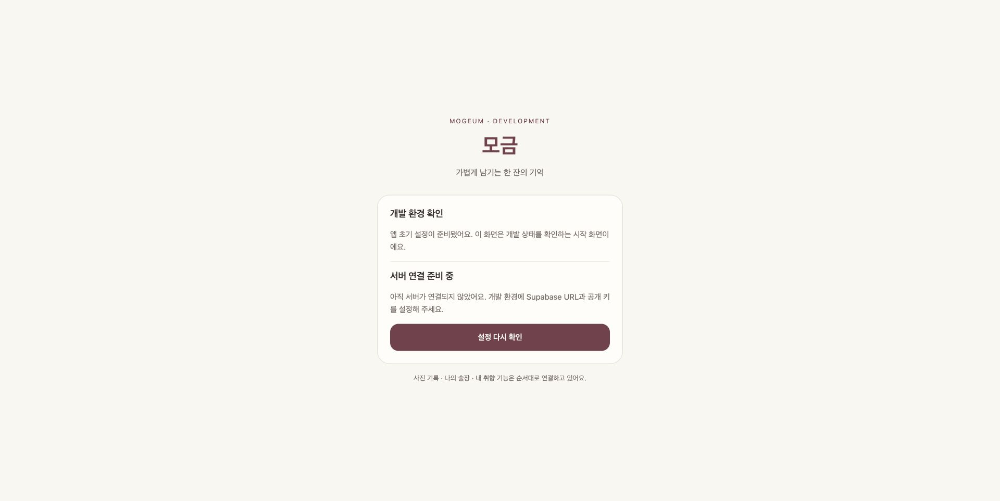
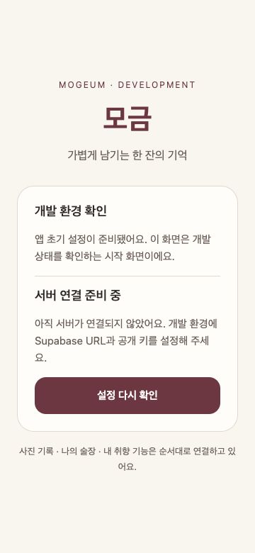

# 앱 초기 설정 검증 · 2026-10-19

## 범위

이슈 #1의 Expo/TypeScript/Router 초기화. 제품용 술장·기록·AI 기능은 아직 미구현이다. 화면은 환경 설정 진단용이다.

## 확인 결과

- Node 24.22.0 / npm 11.12.1에서 `npm ci` 성공.
- `npm run check`: TypeScript, ESLint, 환경 설정 테스트 3개 통과.
- `npx expo install --check`: 호환 의존성 검사 통과.
- `npx expo-doctor`: 20/20 통과.
- `npx expo export --platform all`: iOS/Android Hermes 및 Web static 번들 생성 성공.
- Chrome에서 미설정 안내와 설정 재확인 버튼 동작 확인. 360×780 화면에서 가로 잘림 없이 표시.
- 서버 환경 변수/로그인은 실제 연결하지 않았다. 환경 변수 형식 검증만 제공한다.

## 네이티브 빌드

iOS: Xcode 27.1 / iOS Simulator 27.0 arm64 대상으로 Debug Development Build 생성 성공. `xcodebuild -workspace ios/app.xcworkspace -scheme app -configuration Debug -sdk iphonesimulator -destination 'platform=iOS Simulator,id=<available simulator id>' CODE_SIGNING_ALLOWED=NO build`로 검증했다. 설치·실행은 아직 확인하지 않았다.

Android: 빌드 결과 확인 중. 로컬 검증용 식별자는 `com.example.mogeum.dev`다. 운영 식별자, 서명, 실기기 설치·실행, 네이티브 OCR 검증은 별도로 필요하다.

## 의존성 점검

`npm audit fix`로 비파괴 갱신 후 audit에 26건(High 19 / Moderate 7)이 남는다. 직접 원인 advisory는 braces의 중첩 패턴 DoS, node-forge의 서명 검증, uuid의 buffer 경계 검사이며 Expo CLI/Metro/Xcode 도구 의존성 경로에 전파된다. audit가 제시하는 Expo 44 강제 downgrade는 SDK/RN 호환성을 깨므로 적용하지 않았다. 앱에 이 취약 코드가 번들되는지와 upstream 수정 여부를 출시 전 재평가한다. 26개의 독립 취약점으로 해석하지 않는다.

## 화면

