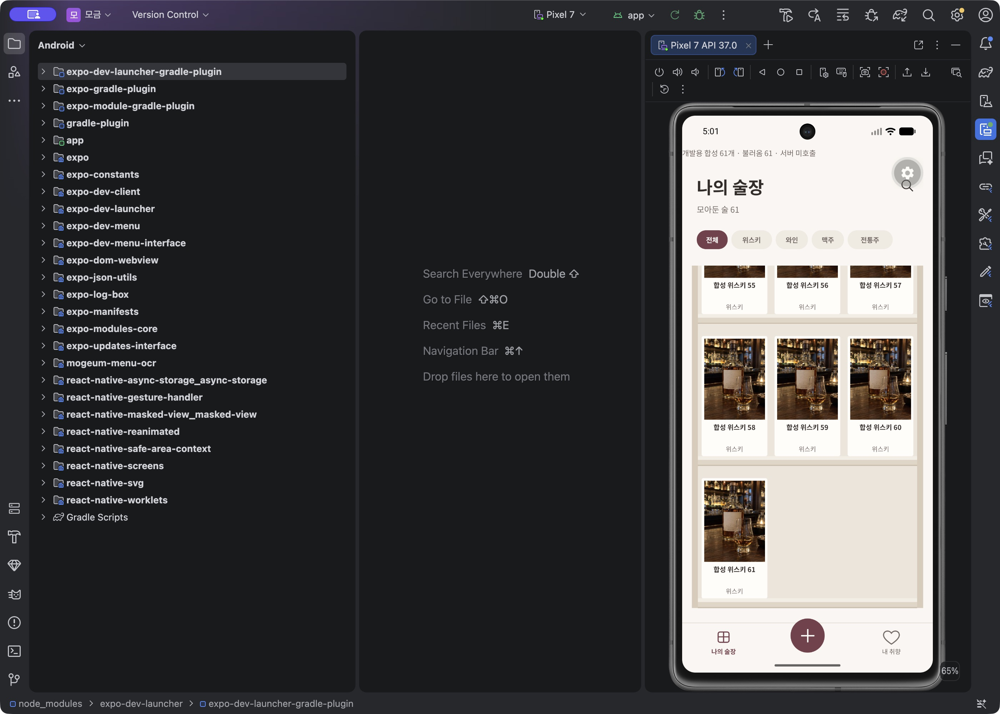
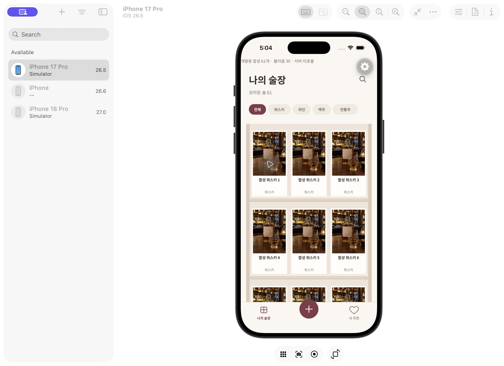

# 술장 cursor 페이지 조회

술장 홈이 전체 목록과 모든 사진 링크를 먼저 기다리던 구조를 30개씩의 cursor 조회로 교체했다. 최신 음용 시각 내림차순·술장 ID 오름차순을 함께 사용한다. DB 시각의 소수점 6자리를 JS Date로 다시 만들지 않고 보존한다. 같은 시각의 기록도 다음 페이지에서 빠지거나 반복되지 않도록 한다.

## 사용 흐름

처음 30개와 해당 대표 사진만 읽고 선반 하단에서 다음 페이지를 가져온다. 검색/주종 필터는 서버 전체 술장에 적용하고 검색 문자열의 %, _와 역슬래시는 LIKE wildcard로 해석되지 않게 한다. 검색 입력은 200ms 지연하고 이전 세대의 응답·cursor·계정 결과는 새 결과에 섞이지 않는다. 헤더 숫자는 필터 결과 수가 아닌 소유한 술장 전체 수다.

추가 요청이 실패해도 앞의 선반과 cursor는 보존한다. 자동 end 이벤트가 반복 재시도하지 않으며 공통 버튼의 ‘다시 불러오기’를 눌렀을 때 같은 cursor로 요청한다. 중복 end 이벤트는 진행 중인 요청을 늘리지 않는다. focus가 바뀌면 이전 pager를 취소하고 돌아올 때 첫 페이지부터 갱신한다. DB 요청 대기 20초·사진 링크 대기 10초는 유지한다.

선반/사진 비율/글꼴/필터/바텀탭의 기존 스타일은 바꾸지 않았다. 초기·추가 로딩/실패 상태는 기존 ActivityIndicator·공통 Button·안내 영역을 재사용한 확장 상태다. 브라우저가 비활성화돼 최신 Figma와 픽셀 비교를 완료한 것은 아니다. 기존 cellar.svg는 과거 반출 원본이므로 최신 디자인 재확인으로 주장하지 않는다.

## 실제 검증

- 실제 로컬 Auth/DB: 같은 microsecond 시각의 독립 술장 35개가 30+5로 조회되고 합친 ID가 정확히 일치한다. 와인 필터 1개·전체 수 35, `100%_`가 포함된 이름의 문자 그대로 검색, 다른 계정의 조회 0개, 잘못된 cursor 거절을 확인했다. 테스트 계정은 finally에서 지정 ID만 정리한다.
- pager 회귀: 중복 end 이벤트, 실패 후 같은 cursor 재시도, 자동 재시도 차단, 중복 ID, 이전 검색 결과 무시, 취소 후 늦은 응답, 반복 cursor 중단을 확인했다.
- 실제 native 로컬 서버: 새 repository의 필터/전체 수/첫 페이지/사진 바이너리 읽기와 기존 기록·메뉴 경로까지 양 플랫폼 각 13단계 통과. [iOS](cellar-cursor/ios-native.json), [Android](cellar-cursor/android-native.json). 지정 합성 계정 4개는 정리했다.
- UI는 별도 `mogeum-dev://dev/cellar` 경로의 **서버 미호출 합성 61개**로 확인했다. Android Studio에서 실제 스와이프로 30→60→61 로딩과 마지막 한 칸 선반·바텀탭을 확인했다. iOS 첫 페이지 렌더링은 확인했지만 Device Hub 제스처가 반영되지 않아 iOS 스크롤 완료는 주장하지 않는다. 이 UI 경로는 실제 DB 35개 검증 및 native 서버 검증과 구분한다.

## 남은 범위

실제 관리형 로그인 전체 UI, iOS 화면의 터치 스크롤, 물리 기기 대용량 성능과 URL 만료 후 갱신은 별도다. 여러 페이지 사이에 DB가 편집되면 서버 snapshot 트랜잭션으로 고정되는 것은 아니며 화면 재진입으로 최신 정렬을 다시 읽는다. 기존 record repository의 offset 조회는 별도 회귀용으로 남지만 홈은 cursor repository만 사용한다.

최종 전체 검사: 216개 중 211 통과, 실제 HTTP/DB 환경 전용 5 skip. 실제 HTTP suite는 별도 4/4 통과·skip 0이다. 기존 전체 일괄 loader와 그 전용 테스트는 제거하고 cursor/pager 계약 및 실제 서버 회귀로 대체했다.
