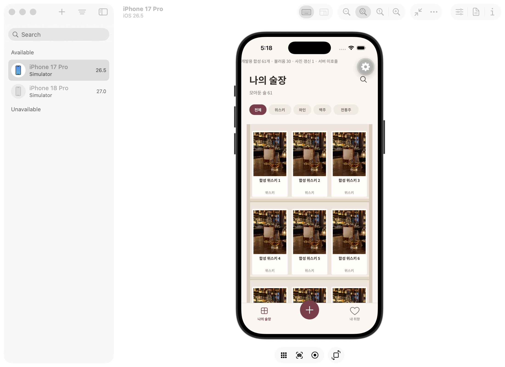
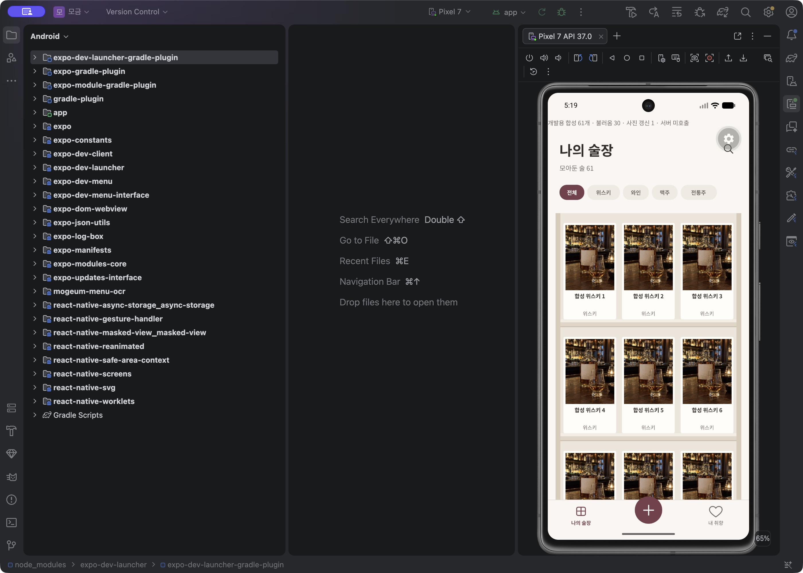

# 술장 사진 링크 만료 후 갱신

5분짜리 signed URL이 만료되거나 이미지 읽기에 실패했을 때 기존 술장은 사진 없음으로 남았다. 이제 native Image.onError에서 현재 pager의 같은 entry/실패 URI인지 확인하고 대표 사진을 owner-scoped view에서 다시 읽어 새 링크를 한 번 발급한다. 경로나 소유자를 UI 입력만으로 결정하지 않는다.

동일 entry는 페이지 세대당 최대 한 번만 갱신한다. 중복 오류·새 링크의 재실패도 무한 발급을 만들지 않는다. 검색/계정/focus 변경 이후 도착한 결과는 반영하지 않는다. 실패해도 기록·선반·cursor는 유지한다. 실제 사진이 없는 경우와 읽기에 실패한 경우의 안내 문구를 구분했다. 선반/사진 비율/타이포/바텀탭 스타일은 유지했고 새 색상/레이아웃을 만들지 않았다.

## 검증 범위

1. 실제 로컬 HTTP에서 1초 TTL 링크를 발급하고 2.1초 후 읽기 거절을 확인했다. owner-scoped refreshPhoto로 다시 발급한 링크는 바이너리 읽기에 성공했다. 실제 HTTP suite 4/4 통과. 5분을 실제로 기다린 검증은 아니며 같은 만료 계약을 짧은 TTL로 확인했다.
2. iOS·Android native에서도 실제 로컬 만료→갱신→바이너리 읽기·다른 계정 거절을 포함해 14단계 통과했다. [iOS](cellar-photo-renewal/ios-native.json), [Android](cellar-photo-renewal/android-native.json).
3. UI는 `mogeum-dev://dev/cellar?photoFailure=1`의 서버 미호출 합성 경로다. 첫 사진에 존재하지 않는 fixture URI를 넣어 실제 native Image.onError를 발생시키고, 같은 pager의 갱신 callback이 정상 fixture를 반환한다. 양 플랫폼에서 갱신 수 1과 첫 사진 복원을 확인했다. 이것을 관리형 만료 사진의 전체 UI E2E라고 주장하지 않는다.
4. 자동 회귀는 한 entry 한 번 제한·중복 오류·이미 바뀐 URI/없는 entry 거절·계정/세대 취소 뒤 늦은 결과 차단·실패 시 기록 보존을 검사한다. 전체 검사 219개 중 214 통과·실제 환경 전용 5 skip.

## 개발 검증 경로 정리 수정

반복 관찰하던 Android canonical 원본 보존 실패를 조사하면서, 기존 native probe가 이미 존재하는 run을 거절해도 finally에서 같은 runId의 원본 cache를 지울 수 있음을 찾았다. 이제 해당 invocation이 다운로드를 시작한 파일만 지운다. iOS에서 거절된 실행의 source marker와 기존 report SHA-256이 유지되고, Android에서도 source marker 및 별도 cache marker가 유지됨을 확인했다. [결과](cellar-photo-renewal/rejected-run-guard.json).

수정 전 이번 Android 실패 보고서도 [보존](cellar-photo-renewal/android-before-guard-fix-failed.json)했다. 수정 후 새 run에서 전체 14단계가 통과했다. 이 결함은 개발용 probe의 정리 경로이며, 과거 간헐 실패 모두가 같은 원인이라고 단정하지 않는다. 테스트 계정 총 8개는 private manifest로 지정해 정리했다.

## 남은 범위

최초 링크 발급부터 실패해 photoUri가 null인 경우는 화면 재진입의 재조회로 복구한다. 자동 갱신 한 번도 실패하면 기존 fallback을 유지하고 재진입 때 새 세대에서 다시 확인한다. 실제 관리형 로그인 E2E와 물리 기기 장시간 네트워크 테스트, 최신 Figma 픽셀 비교는 별도다. signed URL이나 토큰을 공개 보고서에 저장하지 않는다.
