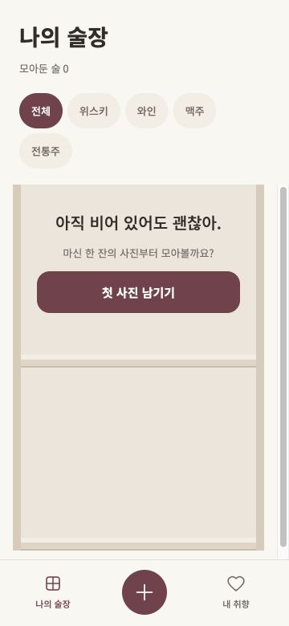
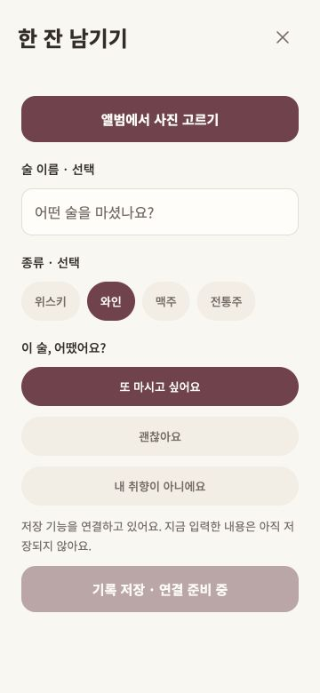

# 공통 UI·술장 첫 구현

2026-10-21, Node 24.22.0. PR #25의 초기 설정 브랜치 위에 구현한 부분 작업입니다.

## 검증

- TypeScript, Expo lint, 도메인 테스트 5개 통과.
- Expo iOS·Android·web export 성공. 네이티브 기기 실행을 의미하지 않습니다.
- Chrome 360×780: 빈 선반·버튼 중앙·가운데 +·하트 표시, 기록 화면 진입, 와인/느낌 선택 확인.
- 0/1/2개 슬롯 정렬과 1,000개 기록 선반 분할·순서·중복 방지 테스트.

## 구현과 한계

토큰, 버튼, 칩, 바텀탭, 3열 가상화 선반, 필터/검색 컴포넌트, 앨범 선택 API 및 취소/오류 처리 경로를 추가했습니다. 앱은 실제 데이터 연결 전이므로 빈 술장으로 시작합니다. 폰트는 번들에 포함됩니다.

Supabase 프로젝트는 아직 없습니다. 로그인·저장·조회·사진 업로드·상세 연결·날짜·빈티지·별점·임시 저장·테이스팅 질문은 후속 작업입니다. 사진 선택은 실제 개인 사진 업로드 없이 API 연결까지만 확인했으며 iOS/Android 권한/선택/취소는 실기기 검증이 필요합니다. 현재 화면을 나가면 입력은 보존되지 않습니다.

Figma MCP는 재인증이 필요해 디자인 컨텍스트를 가져오지 못했습니다. 기존 화면 기준으로 공통 기반을 구현했으며, 최신 Figma와의 세부 시각 일치 검수는 남아 있습니다. #2/#5/#7 완료로 처리하지 않습니다.
