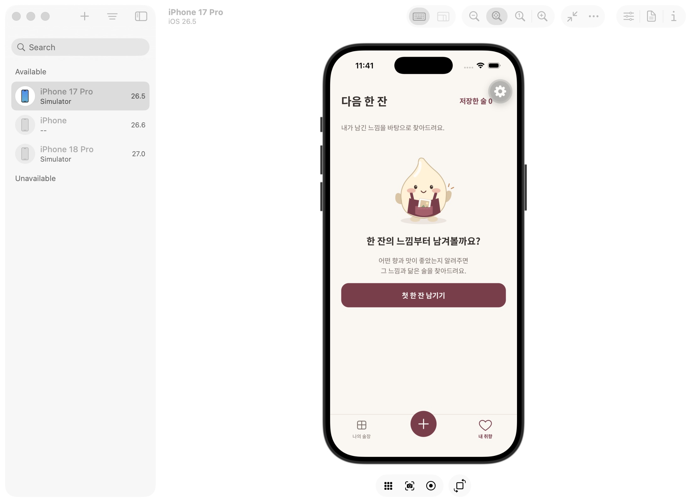

# 다음 한 잔 · 취향 근거 없는 목록 제거

## 원인과 변경

기존 `discoverDrinks`는 사진 기록만 있거나 기록이 없어도 제품 카탈로그 32개를 모두 score 0 / explore로 반환했다. 개별 설명에서는 탐색임을 구분했지만 ‘다음 한 잔’ 제목과 가까운 취향 안내 아래 목록을 노출해 개인화 추천으로 오해하게 했다.

이제 추천은 사용자 기록의 명시적 긍정 평가와 확인한 향·맛 특징이 실제 제품 특징에 연결되고, 긍정 근거가 반대 근거보다 많은 경우만 반환한다. 사진/이름/주종/별점 또는 재음용 의향만으로 향과 맛을 추정하지 않는다. 중립·부정 기록만으로 추천을 만들지 않고, 반대 근거가 더 많은 제품을 목록 채우기용으로 끼워 넣지 않는다. 같은 조건은 앱 전송 경계와 목록에도 적용해 이전 관리형 함수가 탐색 목록을 반환해도 개인화 추천으로 표시하지 않는다. 기존 응답 검증과 사용자 저장 목록은 유지한다.

별도의 취향 설문을 완료해야 하는 구조는 아니다. 평가와 감각을 남긴 한 기록부터 비교할 수 있다. 정보가 적으면 기록에 한정한 발견이며 전체 취향으로 단정하지 않는다.

## 화면

- 근거 없음: 기존 모구·토큰·공통 버튼을 사용해 ‘한 잔의 느낌부터 남겨볼까요?’ 표시. 추천 목록/빈 주종 필터를 숨긴다. 기록 0개는 기록 작성, 기존 기록이 있으면 술장으로 연결한다.
- 감각 기록은 있으나 비교할 긍정 근거 없음: ‘아직 닮은 한 잔을 찾지 못했어요.’ 표시.
- 선택한 주종에만 일치 없음: 해당 주종의 빈 상태와 전체 주종 보기 제공.
- 사용자가 직접 저장한 술은 취향 추정과 분리해 보존한다.

빈 상태는 기존 Figma의 구성 요소로 만든 확장 상태이며 새 원본 프레임과의 픽셀 일치 검증은 아니다. 추천이 있을 때의 43/45 리스트 구조와 공통 바텀탭은 유지한다.

## 검증

- 단위: 기록 0개/사진만/중립/부정만/상반된 근거 동률 → 추천 없음. 긍정 근거 우세 → 실제 지지 기록과 반대 근거 유지. 기록에 이미 있는 제품 제외, 다른 주종의 맛·질감 추론 금지 유지.
- 전송: 명시적인 이전 배포 응답 fixture(32개 탐색 행)가 비개인화 목록으로 제거되며 북마크 보존. 제품/URL 조작·잘못된 근거 참조 거절 유지.
- 로컬 실제 Auth/Edge API: 빈 계정의 raw 응답이 빈 추천 목록인지 확인. 임시 기록·확정 노트 추가 후 실제 연결된 추천과 근거를 확인. 다른 계정은 여전히 빈 목록/근거/북마크이다.
- iOS: 기존 로그인된 기록 0개 계정에서 빈 화면을 확인했고 첫 기록 CTA가 실제 작성 화면으로 연결됨을 확인했다. 해당 계정의 기록을 만들거나 로그인 상태를 변경하지 않았다.

관리형 서버의 최신 함수 배포는 별도이며, 기존 배포 응답에 대한 앱의 차단은 실제 iOS에서 확인했다. Android UI 확인은 아직 하지 않았다.
