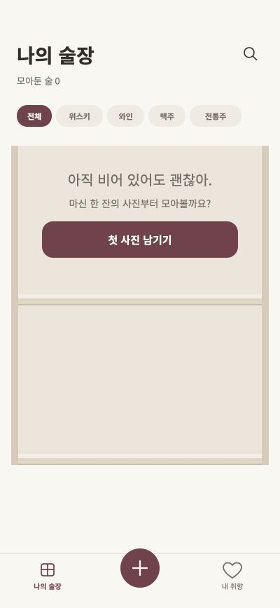
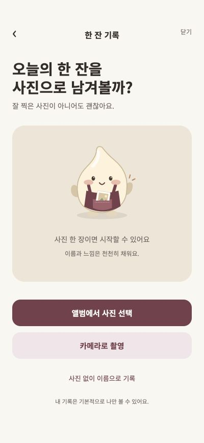
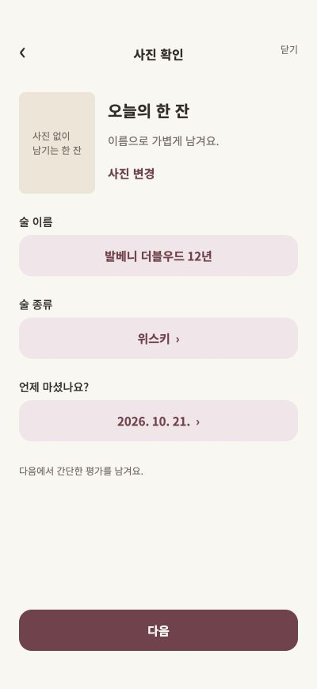
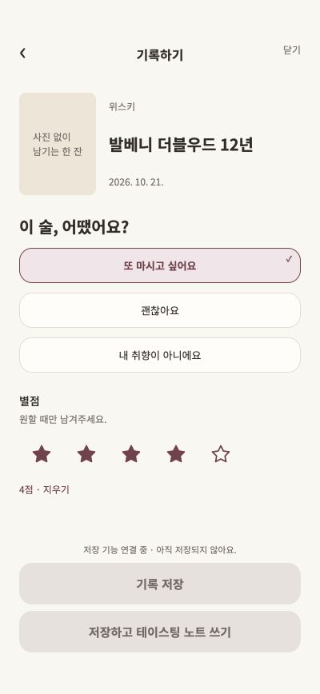
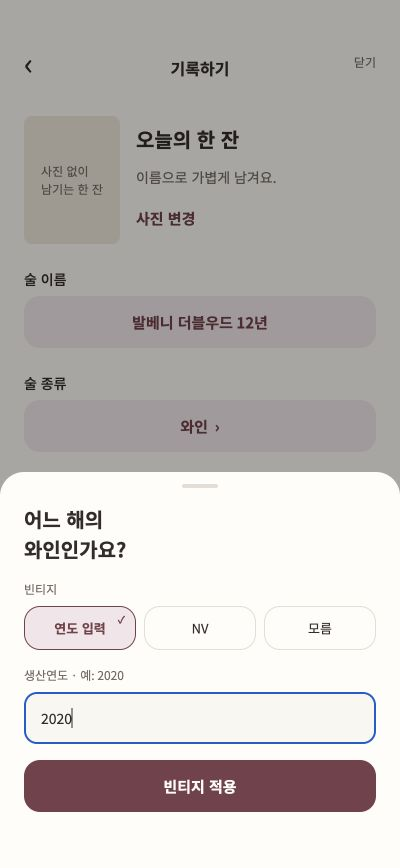

# Figma 원본과 구현 정렬 · 2026-10-21

## 근거

Chrome에서 `04 · 화면 정리본`, `01 · 디자인 시스템`, `02 · 컴포넌트` 페이지를 확인했습니다. 원본 프레임은 다음과 같습니다.

|화면|Figma node|내보낸 원본|
|---|---|---|
|빈 술장|4:3083|figma-reference/cellar.svg|
|기록 시작|4:3689|figma-reference/record-start.svg|
|기본 정보|4:3737|figma-reference/record-info.svg|
|기본 평가|48:1162|figma-reference/record-rating.svg|
|내 취향 첫 발견|04의 28번 프레임|Chrome에서 배치 확인|

원본 SVG는 브라우저의 Figma 내보내기로 받았으며 비교/수치 확인 자료입니다. 화면 전체 SVG를 앱 UI로 사용하지 않습니다. 모구·탭 아이콘·별은 원본 벡터 경로를 개별 컴포넌트로 사용합니다. Figma MCP는 재인증 오류로 사용할 수 없어 Chrome에서 직접 확인했습니다.

## 변경

- 제목 28px / 필터 11px·31px 높이 / 버튼 15px·52px 높이·16px 모서리.
- 고정 헤더 208px(기기의 상단 안전영역은 별도 적용), 선반 228px, 좌우 여백 16px.
- 필터 줄바꿈 제거, 검색 아이콘 추가, 가운데 +가 위로 7px 올라오는 최신 탭 구성 반영.
- 기록 시작 → 기본 정보 → 평가로 분리. 모구 원본, 사진 96×128, 날짜·주종 선택, 와인 빈티지, 평가와 선택 별점 반영.
- 선택 칩의 기본/선택 상태를 원본의 테두리·연한 버건디·체크 표시로 변경. 주종 필터만 별도의 작은 pill 형태 사용.
- 내 취향은 원본 첫 발견 화면의 타이포와 배치 기반으로 정리. 기록 0개는 Figma의 2개 기록 예시를 실제 데이터처럼 표시하지 않도록 빈 상태 문구로 처리했습니다. 0개 전용 화면이 원본에 없으므로 원본과 동일한 문구로의 비교 대상은 아닙니다.

## 검증 및 제약

400×868에서 원본과 배치를 비교했습니다. 320×700에서 필터 5개 한 줄 배치·하단 탭·세로 스크롤을 확인했고, 빈 상태 안내 문구는 버튼보다 넓은 원본 텍스트 영역을 유지하도록 보완했습니다. 날짜·주종 변경, 평가 선택·별점, 이전 단계 값 유지, 빈티지 2020 입력 후 반영을 확인했습니다. 앱의 상태바와 홈 인디케이터는 OS가 담당하며 브라우저에 가짜 9:41/인디케이터를 그리지 않습니다. 폰트 확대 시 텍스트가 커질 수 있고 필터는 가로 스크롤합니다.

실제 저장·AI는 여전히 미연결입니다. 저장 버튼을 비활성화하고 연결 상태를 명시하므로 원본의 활성 저장 상태와 의도적으로 구분됩니다. 카메라·앨범은 실기기 검증 전입니다. Chrome 자동 파일 선택은 확장 프로그램의 파일 URL 접근 설정으로 차단되어 사진 첨부 완료를 검증하지 못했습니다. 선택 취소 후 기존 입력은 유지됩니다.

기본 정보/평가 캡처는 사진 없이 기록 경로입니다. 임의의 개인 사진을 레포에 넣지 않습니다. 날짜·주종 바텀시트도 Chrome 원본과 비교하여 선택 배경, 기타 옵션과 간격을 보완했습니다. 와인 빈티지 시트도 원본의 연도 입력/NV/모름 3열 방식으로 수정했습니다. 0개 취향 전용 화면은 원본에 없어 확정이 필요합니다.

## 현재 화면

