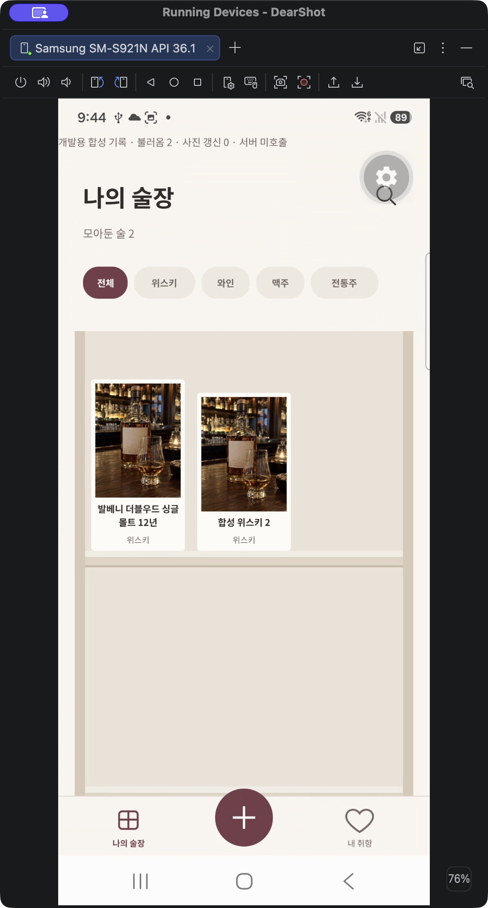
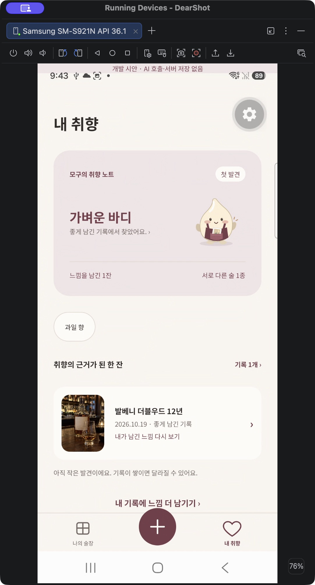
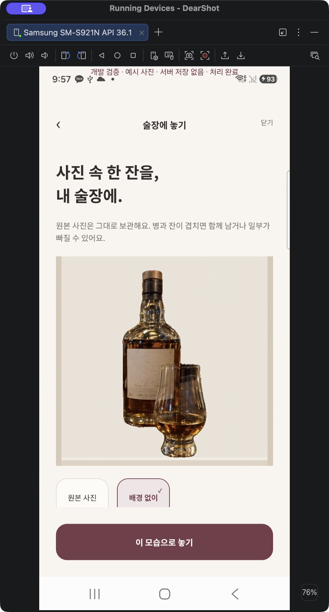

# Galaxy QA: 술장 간격·취향 레이아웃·원본 SVG · 2026-10-27

관련 #165, #7, #64, #96. 실제 사용자 기록은 변경하지 않았다.

## 확인한 UI

Galaxy S24 SM-S921N / Android 16.1 USB 기기에서 CUA로 다음 화면을 확인했다. `/dev` 합성 화면이며 로그인·AI 호출·서버 저장을 하지 않는다.

- 주종 4종과 북마크의 Figma 원본 SVG가 실제 표시됨. 원본 5개 XML SHA256가 기존 에셋 manifest와 일치한다. Debug HTTP 에셋과 로컬 Release APK 번들 에셋에서 모두 확인했다.
- 내 취향: 기록 0개·기록 1개 요약·기록 변경 후 재분석 상태. 모구·요약·수량을 묶은 헤더와 세로 비율의 근거 썸네일, 두 개의 간결한 진입 행을 확인했다.
- 술장: 이름의 고정 높이를 없애 한 줄 이름 아래 불필요한 공간이 제거됨. 기록 2개·긴 이름 두 줄일 때 선반 아래 정렬과 3:4 사진 비율 유지.
- iOS 작은 화면 Simulator에서 요약·근거 카드·바텀탭이 잘리지 않음을 확인했다. iPhone 실기기 검증은 아니다.

실제 화면 PNG는 로컬 `artifacts/qa/165-taste/`에 있다. 개발 화면의 테스트 안내/도구는 베타에 포함하지 않는다. 테스트용 `/dev` 경로는 `.easignore`에서 제외한다.

## 추천 방식

현재 다음 한 잔은 `evidence-rules-v1`, `modelUsed:false`, `limitedCatalog:true`다. 출처를 확인한 제품 특성과 내 느낌 기록을 비교한다. Gemini 실시간 제품 검색으로 소개하지 않는다. Gemini 취향 요약은 별도의 서버 기능이며 해당 근거 검증 계약은 유지한다.

## 배경 분리

Galaxy Debug에서 실제 ML Kit가 bundled 위스키 사진을 처리했다. 약 756ms, 201×447 PNG, alpha 채널 있음. CUA로 원본→배경 없이 선택 후 선반 위 병과 잔이 보이는 것을 확인했다. 같은 사진 한 장의 검증이며 모든 사진 품질을 보증하지 않는다. 결과는 `artifacts/qa/165-taste/cutout/`에 있다.

Release에서만 발생하는 ML Kit 내부 provider null 오류를 재현했다. subject SDK만 보존하면 공통 `ExecutorSelector` 의존성 누락으로 초기화가 실패하여, subject와 ML Kit common 패키지를 함께 보존했다. 같은 Galaxy에서 수정한 minified Release의 실제 처리 완료를 확인했다. 전체 앱의 최적화를 비활성화하지 않는다. Expo prebuild에서도 보존 규칙 파일 연결이 생성되는 것을 확인했다.

별도 로컬 진단 빌드만 일시적으로 fixture 화면을 허용했으며 배포 대상이 아니다. 빌드 후 `__DEV__` 가드를 복구했고 베타 아카이브에는 `/dev` 자체를 제외한다. 실제 베타 업데이트 설치 완료와는 구분한다.

## 자동 검증

`npm run check`: 405개 중 397 통과, 환경 의존 8개 건너뜀, 실패 0. 첫 모델 준비 오류만 제한적으로 재시도하고 다른 오류/iOS에는 재시도하지 않는 두 테스트를 추가했다. 로컬 실험 산출물의 임시 `/tmp` 참조가 앱 타입 검사 대상이 되지 않게 `artifacts/**`를 제외했다. 제품 소스·테스트는 계속 검사한다.

## 관리형 서버 상태 확인

Supabase CLI로 기존 개발 프로젝트의 `taste-summary` v8, `menu-recommend` v11, `next-drinks` v5, `delete-account` v4, `provider-credentials` v2가 모두 ACTIVE임을 재확인했다. 이번 변경은 클라이언트 UI/네이티브 빌드이며 서버 재배포를 요구하지 않는다. 함수 ACTIVE는 모든 인증 계정의 전체 흐름 성공을 의미하지 않는다.

## 합성 화면 증거

