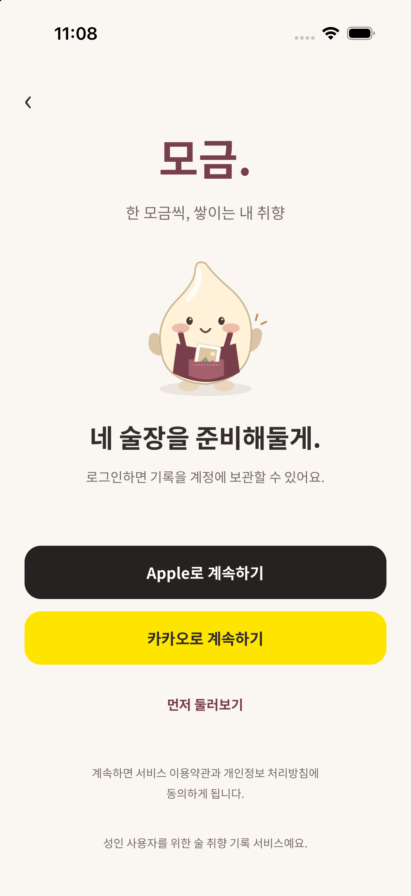
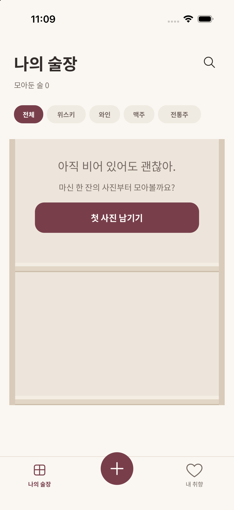

# 실제 프로젝트·로그인 화면·기록 연결 · 2026-10-21

## 구현

- 사용자가 생성한 Mogeum / mogeum-dev (서울) 프로젝트에 기록 foundation/transaction migration을 SQL Editor에서 하나의 transaction으로 적용했다. public 테이블 10개와 cellar_overview, private record-photos bucket, RLS, 저장·수정·이동 RPC가 포함된다. 새 개발 프로젝트만 변경했고 meomun은 변경하지 않았다.
- URL과 Publishable key는 gitignore된 로컬 .env에만 저장했다. service role/provider secret은 앱에 없으며 환경 설정 파일을 커밋하지 않는다.
- Site URL은 http://localhost:8082, 추가 redirect는 mogeum-dev://auth/callback, http://localhost:8082/auth/callback, http://localhost:8081/auth/callback로 제한했다. 출시용 HTTPS 도메인/앱 링크와 실제 식별자는 후속 설정이다.
- 로그인 4:3036을 Chrome FigmaScript의 원본 Plugin API로 읽었다. 커넥터는 재인증 오류가 있어 원본 SVG/레이어 수치를 docs/verification/figma-reference/login.{svg,json}에 보관했다. 임시 검사 텍스트는 제거했으며 사용자 디자인은 수정하지 않았다. SVG 전체 화면은 비교 근거일 뿐 앱 UI로 사용하지 않는다.
- 기존 공통 Button에 원본 Apple/Kakao 색상 variant를 추가하고 기존 모구 컴포넌트를 재사용했다. 로그인 화면의 로고·문구·간격, 기존 술장/기록 레이아웃을 유지한다.
- OAuth PKCE, 공급자 활성화 확인, 취소/실패 복구, 네이티브 복귀 URL 검사, router/browser 양쪽에서 전달된 한 번용 code의 단일 교환을 구현했다.
- 둘러보기는 비로그인 빈 술장이다. 기록 진입 시 로그인하며 가짜 계정/예시 기록/성공 응답은 넣지 않는다.
- 기본 저장 버튼은 실제 업로드→RPC→술장 재조회에 연결했다. 이름/사진 중 하나, UI 기본 느낌 필수, 별점 선택, 주종/빈티지 enum을 기존 서버 계약으로 변환한다. 테이스팅 질문/문장 화면은 이번 연결 범위 밖이며 보충 노트 버튼은 계속 비활성이다.
- 사진을 JPEG/긴 변 최대1600px로 정리하고 네이티브는 앱 document 폴더, 웹은 data URI로 보관한다. 저장 시 사용자별 pending payload/operation ID를 AsyncStorage에 먼저 기록한다. RPC 응답 유실·앱 재실행 시 원래 입력으로 재시도하며 업로드는 덮어쓰지 않는다. 저장 receipt 이후에만 pending을 정리한다.
- 계정 변경 시 composer를 새 key로 마운트하고 진행 요청은 원래 JWT에 고정한다. 전역 세션 변경으로 다른 사용자 계정에 기록을 저장하지 않도록 한다. 술장 결과는 owner ID가 일치할 때만 표시한다.

## 실행한 검증

- 실제 개발 프로젝트 Auth settings 200, Apple/Kakao false 확인. 비로그인 Data API cellar_overview/tasting_records 조회는 401 / 42501로 차단됐다.
- 400×868 브라우저에서 Apple 버튼 x24/y501/352×52, 원본 #252322 및 카카오 #FEE500 확인. 로그인·둘러보기·비로그인 + 진입의 로그인 유도, 공급자 미설정 시 앱 안의 오류/재시도 확인. 320px 술장 캡처도 보관했다.
- 타입/린트·로컬 33개 중 31개 테스트가 통과했다(서버 필요 2개 skip). [앱 CI](https://github.com/shinhanseo/mogeum/actions/runs/39612770488)는 Expo 호환성·전체 export까지 통과했고, [Supabase CI](https://github.com/shinhanseo/mogeum/actions/runs/39612770407)는 SQL 정책·동시성 및 실제 Auth/Storage/기록 파이프라인 통합 검사를 통과했다. 실제 개발 프로젝트 SQL 조회도 tables=10, rls_tables=10, record_rpcs=3, private_bucket=true를 반환했다.
- 실제 Auth/Storage/SDK/저장 파이프라인 검사는 일회성 Supabase CI에서 수행한다. 사용자 프로젝트에서 이메일 확인을 끄거나 가짜 로그인 우회를 추가하지 않았다.

## 완료하지 않은 것

사용자가 Apple Services ID/카카오 앱을 아직 만들지 않았다고 확인했다. 두 provider는 현재 비활성이며 실제 소셜 로그인, 사용자 프로젝트에서 앱 UI를 통한 사진 저장/재실행 성공, iOS/Android 물리 기기의 OAuth·파일 복원은 검증할 수 없다. 공급자 등록/credential 설정 뒤 재검증해야 하며 이슈를 닫지 않는다. 저장 RPC/SDK의 CI 성공을 사용자 앱의 소셜 로그인 성공으로 보고하지 않는다.

편집 중 모든 단계의 자동 draft는 아직 없고, 저장을 누른 시점부터 pending을 보관한다. 업로드 이후 저장 실패의 장기 고아 파일 정리 worker, 계정 삭제, signed URL 주기 갱신, 술장 원격 무한 스크롤/검색 최적화도 후속이다. 현재 술장은 페이지 API로 전체를 읽어 기존 선반 FlatList로 표시한다.

클라우드 적용은 SQL Editor로 했으므로 Supabase CLI migration history와 아직 연결하지 않았다. 향후 CLI 연결 시 기존 두 migration을 다시 적용하지 말고 적용 내용 확인 후 migration repair로 history를 맞춘 다음 새 migration을 배포한다. 이번에는 기존 데이터 파괴나 db reset을 실행하지 않았다.

## 공급자 설정

- 공통 provider callback: `https://vsckzjfgzdpzkzuumldf.supabase.co/auth/v1/callback`
- 카카오: 개발자 앱/REST API key·Client Secret, 카카오 로그인 활성화 및 위 callback 등록 후 Supabase Kakao provider에 설정.
- Apple: 소유한 App ID/Services ID/Sign in with Apple key, domain `vsckzjfgzdpzkzuumldf.supabase.co`와 위 return URL 설정 후 Supabase Apple provider에 입력. 키 만료/회전도 운영 절차에 포함한다.
- 비밀 키는 사용자/서버 설정에만 보관하고 채팅·PR·EXPO_PUBLIC_에 붙이지 않는다.

공식 문서: [Kakao](https://supabase.com/docs/guides/auth/social-login/auth-kakao), [Apple](https://supabase.com/docs/guides/auth/social-login/auth-apple), [PKCE code exchange](https://supabase.com/docs/reference/javascript/auth-exchangecodeforsession).

## iOS 시뮬레이터 검증

사용자 요청에 따라 이후 화면 검증을 iOS 네이티브로 전환했다. Xcode 27.1 / iPhone 17 Pro / iOS 26.5 / 로컬 검증 식별자 com.example.mogeum.dev에서 Development Build 생성·설치·실행에 성공했다(0 errors, 2 build warnings). Xcode 27에서는 시뮬레이터 창이 Device Hub 앱에 있다.

- 네이티브 Noto Sans KR·모구·Apple/카카오 버튼과 하단 문구 표시 확인.
- 실제 HTTPS Auth settings 호출 후 공급자 미설정 안내로 복구됨을 확인.
- 둘러보기 → 빈 술장 → 내 취향 탭 → 가운데 + → 로그인 유도 확인.
- 네 주종 필터가 한 줄로 유지되고 가운데 +와 하트 상단이 잘리지 않음 확인.
- 앱 종료/재실행 후 비로그인 로그인 화면 재진입 확인. 로그인된 세션 복원이나 사진 영속 복원의 성공 검증은 아니다.
- 설치된 Supabase SDK 2.118 내부 구현에서 lockless 세션 조정이 기본이고 processLock 옵션이 deprecated인 것을 네이티브 로그로 발견해 옵션을 제거했다.
- 이미지가 한 번 실패한 뒤 새 signed URL을 받아도 실패 상태를 유지하던 술장 카드도 새 URI에서 다시 렌더하도록 수정했다. 서버 기록이 생기면 내 취향의 기록 개수는 실제 합계로 표시하며 AI 분석 문구를 만들지 않는다.

재현: Node24 환경에서 `MOGEUM_IOS_BUNDLE_ID=com.example.mogeum.dev MOGEUM_ANDROID_PACKAGE=com.example.mogeum.dev npx expo prebuild --platform ios`, `npx expo start --dev-client --port 8081`, 별도 터미널에서 같은 식별자로 `npx expo run:ios --device <simulator-uuid> --no-bundler`. Metro의 실제 host/port에 맞춰 development client를 연다. CLI의 --port와 --no-bundler는 함께 쓸 수 없다. ios/와 빌드 산출물·서명 정보는 커밋하지 않는다.

