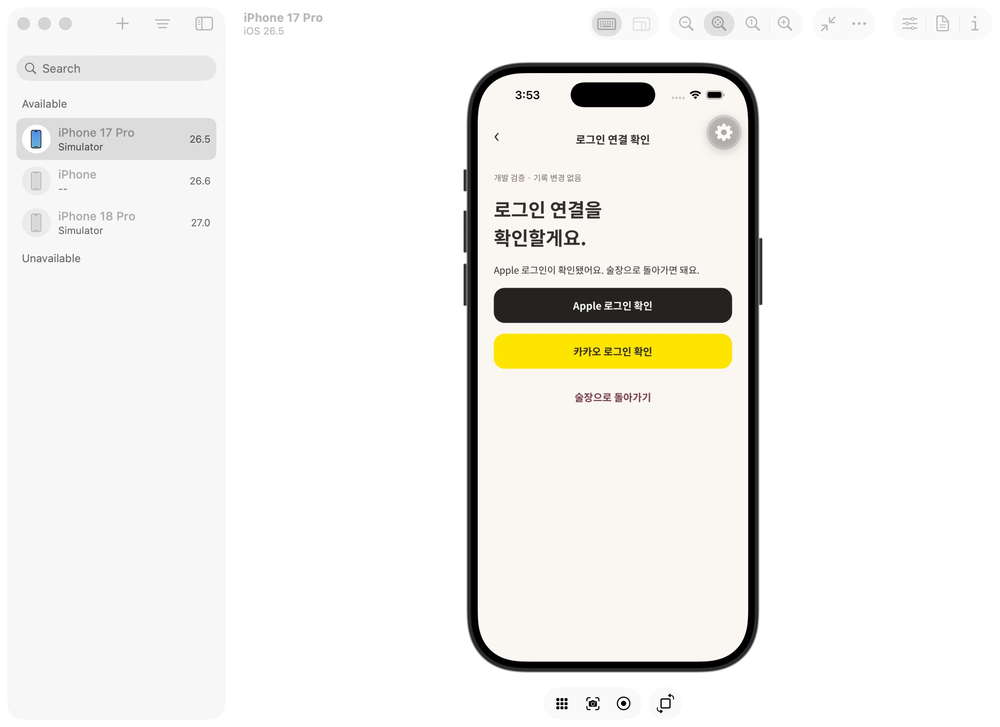

# 관리형 개발 서버 연결 검증 · 2026-10-25

대상은 사용자 승인된 `mogeum-dev` (`vsckzjfgzdpzkzuumldf`)이다. 개인 기록은 생성·수정·삭제하지 않았다. 전용 태그가 있는 임시 계정 2개씩으로 검증한 뒤 모두 정리했다. 관리자 키는 저장소 밖 소유자 전용 파일에서만 읽고 결과에는 키·세션·이메일·사용자 ID를 남기지 않았다. 비용/결제 설정을 변경하지 않았다.

## 배포

- 술장 ready 사진 fallback migration `20261025090000` 및 삭제 migration `20261025120000`을 트랜잭션으로 적용했다. 이 프로젝트는 기존에 대시보드로 스키마를 적용해 `supabase_migrations.schema_migrations` 테이블이 없으므로 CLI 이력 완료로 표현하지 않는다. 실제 `account_deletion_status()`, `private.account_deletions`, ready 사진 필터 view를 조회해 적용을 확인했다.
- `delete-account-01ce2a2f7e3722a6` 단일 파일 배포. 원래 함수를 Deno 검사하고 생성한 번들로 로컬 Auth/Storage/Edge 통합을 통과한 뒤 배포했다. 함수 안에서 `Auth.getUser`로 검증하고 영수증은 이미 완료된 작업 확인에만 사용한다. legacy JWT gateway 검증은 원본 설정과 같이 사용하지 않는다. 익명 요청이 실제 함수의 build header와 함께 401을 반환했다.
- `next-drinks-68e91384a6bb2061` 배포 후 임시 계정의 raw 응답에 추천 0개인 것을 확인했다. 이전 앱 필터만 통과한 결과와 구분해 두 번째 검증 파일에 기록했다.
- 메뉴판 배포는 이미 최신 `menu-cb7ea451e5d61969`임을 확인했다. 이 항목은 새로 배포했다고 표현하지 않는다.

## 실제 관리형 검증

[AI 및 삭제](managed-ai-and-deletion.json): 전용 임시 계정 → PNG Storage 원본 → 기록 3개 → 확정 향 답변 → `taste-summary` → 실제 Gemini `gemini-3.8-flash` → 근거 ID 검증 및 DB cache 저장. 과일 향 한 종류만 합성 입력으로 사용했다. 그 뒤 실제 추천 근거를 확인했다. 이 첫 실행은 최신 추천 배포 전이라 서버 raw 추천 32개를 받았고 앱 parser에서 제거했다.

[최신 추천 및 삭제 재검증](managed-discovery-and-deletion.json): 서버 raw 추천 0개 확인 → 확정된 긍정 기록 후 근거 있는 추천 19개 → A의 사진 원본·기록·노트·Auth 제거 → B 유지 → 삭제 전 토큰 재요청 완료. 이 두 번째 검증은 불필요한 모델 재호출 없이 진행했다. 두 실행 모두 임시 계정 cleanup 완료를 확인했다.

## iOS Apple

사용자가 인증·동의를 직접 완료했다. 개발 검증 화면이 기존 세션과 다른 새 세션, 서버 `getUser`, Apple identity를 확인한 뒤 성공 문구를 표시했다. [비밀 값 없는 결과](ios-apple-proof.json)는 provider access/refresh token의 존재 여부만 포함한다. 토큰 값 자체를 공개 결과에 저장하지 않았다. 술장 복귀 및 앱 종료→재실행 후 로그인 보호된 술장 복원까지 관찰했다.

## 남은 범위

Apple/Kakao grant revoke/unlink 구현과 그 실패 재시도는 아직 남아 있다. provider token이 있다는 것만으로 해제를 완료했다고 표현하지 않는다. 실제 사용자 계정의 삭제 버튼은 누르지 않았다. 계정 삭제의 iOS/Android 실제 UI→서버→재실행 전체 검증, Android OAuth, 배포용 테스터 빌드 및 메뉴판 native OCR부터 관리형 저장/추천까지의 통합 검증이 남아 있다.
