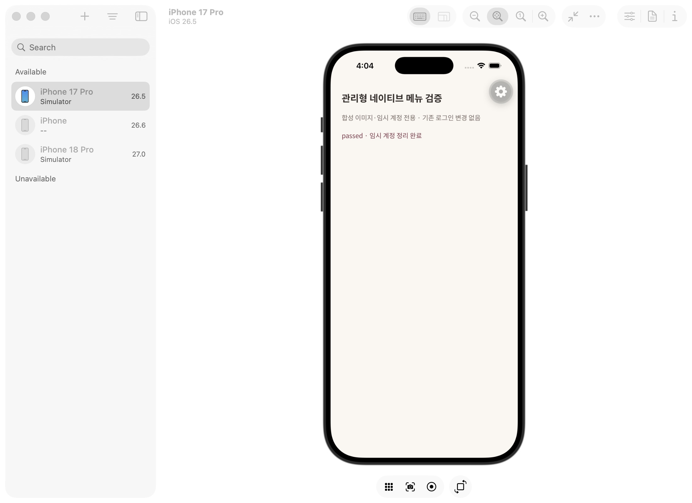

# 양 플랫폼 네이티브 OCR → 관리형 메뉴 추천 · 2026-10-25

사용자 승인된 `mogeum-dev`만 대상으로 전용 태그의 임시 계정 A/B를 생성해 검증했다. 사람 계정의 기록·로그인 상태를 변경하지 않았다. 검증이 끝난 뒤 모든 임시 Auth/DB 자료와 기기 준비 사진/메뉴 초안을 정리했다. 관리자 키는 호스트에만 보관하고 기기에는 제공하지 않았다.

## 실행 경로

`MOGEUM_VERIFY_MANAGED_DEV=1 npx tsx scripts/serve-managed-native-menu.ts`는 정확한 개발 프로젝트와 비공개 서버 자격 증명 파일을 확인한다. 새 임시 계정과 합성 위스키 기록을 만든 뒤 10분 제한의 loopback 서버에서 해당 실행의 임시 세션만 전달한다. nonce가 일치하는 개발 경로만 사용하고 브라우저 Origin 요청은 거절한다. 호스트의 비공개 journal은 임시 계정 정리가 끝나야 제거된다. 서버 키·세션·개인 ID는 결과 JSON/로그에 넣지 않는다.

`/dev/managed-menu-probe`는 __DEV__ + native에서만 실행한다. 정확한 개발 URL과 두 계정의 서버 인증·전용 실행 태그를 확인하고 `persistSession:false` SDK를 사용한다. 기존 앱의 실제 로그인 SDK는 재사용하지 않는다. OCR 합성 이미지 2장을 내려받아 네이티브 사진 준비와 OCR을 새로 실행한다. 이 이미지는 카메라 촬영 사진이 아니므로 카메라 권한/실사 메뉴 품질 검증과는 구분한다.

## 확인한 결과

| 경로 | iOS | Android |
|---|---|---|
| 현재 네이티브 OCR 실행 | apple-vision-v2 | mlkit-korean-16.0.1 |
| 입력 사진 | 2장 | 2장 |
| OCR 줄 | 13 / 13 | 13 / 13 |
| 관리형 geometry-v3 해석 | 12개 메뉴 | 12개 메뉴 |
| 수정본 기기 저장/복원 및 raw OCR 보존 | 통과 | 통과 |
| 관리형 메뉴 저장 및 동일 요청 replay | 통과 | 통과 |
| 다른 계정 read/write 차단 | 통과 | 통과 |
| 확정 노트 → 메뉴 추천 → 해당 기록 ID 근거 | 통과 | 통과 |
| 다른 계정 추천에 내 근거 유출 없음 | 통과 | 통과 |
| 합성 계정·준비 파일 정리 | 통과 | 통과 |

[iOS 실행 결과](ios-result.json), [Android 실행 결과](android-result.json). 서버의 이전 캡처 OCR replay 검사도 별도로 실행해 [결과](server-replay-result.json)를 남겼다. 이 replay 결과를 새 native 실행이라고 혼동하지 않는다.

Android 검증용 emulator-5556만 사용했다. 기존 개발 클라이언트 재연결 중 `App react context shouldn't be created before` native 충돌이 발생해 해당 검증 앱 프로세스만 force-stop 후 Metro8081에 재연결했다. 앱 데이터는 초기화하지 않았고 별도 Pixel emulator-5554는 건드리지 않았다. 이후 실제 Android 번들 및 native OCR→관리형 성공 결과를 확인했다. Android Studio 창의 CUA 스크린샷을 얻지 못했으므로 Android 시각적 레이아웃·버튼 정렬 확인으로 표현하지 않는다.

## 남은 범위

실제 사용자 사진의 다양한 조도/반사/복잡한 메뉴판 평가, 카메라/앨범 권한 UI부터 사용자가 화면을 눌러 저장하는 전체 조작, 중간 네트워크 단절·복구, 출시용 release build/TestFlight 및 Android 테스터 배포는 남아 있다. 합성 native probe는 이 항목들을 대체하지 않는다.
