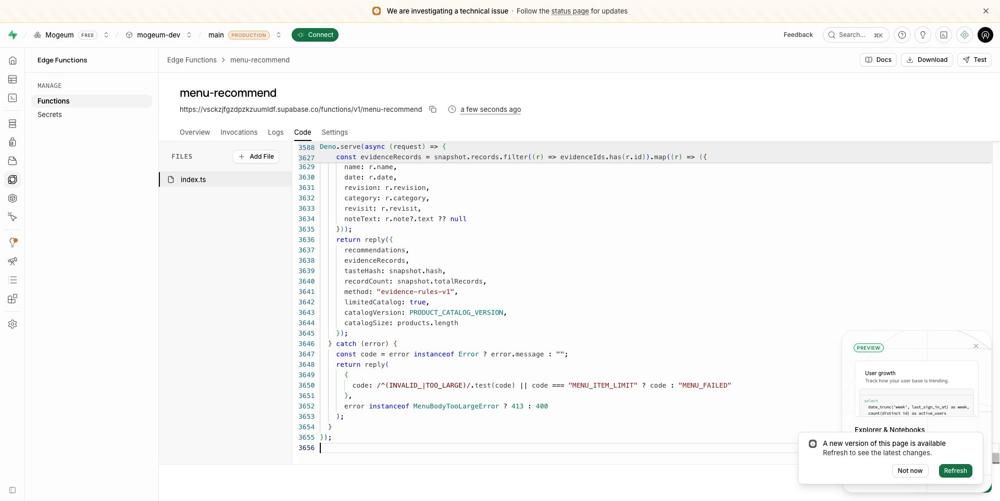

# 메뉴 함수 개발 프로젝트 배포 · 2026-10-23

Supabase `mogeum-dev`의 `menu-recommend`를 최신 공유 모듈을 포함한 단일 파일로 배포했다. 출처 카탈로그 32제품, geometry-v2, apple-vision-v2 입력, 과대 본문 제한을 포함한다. Gemini 모델 연결을 의미하지 않는다.

- 빌드 ID: `menu-4548afbfd3ae9a51`
- 배포 파일 SHA-256: `d1867446f369b9a30cba2fc65fc9884a3f1ece12772e704070264946620653ec`
- 파일 크기: 104416 bytes
- 대시보드 편집기 내용을 다시 읽어 로컬 산출물과 완전히 일치하는지 확인한 후 배포했다.
- 외부 POST에서 같은 `X-Mogeum-Build`, HTTP 401, `UNAUTHENTICATED`, `Cache-Control: no-store`를 확인했다. 인증 없는 요청이 차단된다는 증거이며 인증 후 추천 성공의 증거는 아니다.

## 재현 가능한 산출물

`npm run build:menu-function`은 esbuild 0.28.2로 공유 TypeScript를 묶는다. 기본 출력은 OS 임시 폴더의 `mogeum-menu-deploy/index.ts`이며 저장소 안에는 출력하지 않는다. manifest에는 빌드 ID·파일 해시·크기만 기록한다. 환경 키를 읽거나 번들에 넣지 않는다. 산출물은 편집하지 않고 원본 TypeScript를 수정한 뒤 다시 생성한다.

원본은 `npx -y deno check supabase/functions/menu-recommend/index.ts`로 검사한다. 생성된 파일의 `@ts-nocheck`는 번들에서 타입이 제거되기 때문이며 원본 검사를 대체하지 않는다.

로컬 Supabase와 함수 serve가 실행 중일 때 `npm run test:menu-deploy`는 임시 백업 후 원본 엔트리를 생성 번들로 교체하고 런타임 빌드 ID·401을 확인한다. 이어 실제 Auth/Storage/Data API HTTP 회귀를 실행하고 finally에서 원본을 복원한다. 이 검증은 작업 중인 함수 파일을 잠시 교체하므로 같은 checkout에서 다른 함수 편집과 동시에 실행하지 않는다. 관리형 서버에는 테스트용 계정을 만들거나 데이터를 쓰지 않는다.

## 남은 검증

Apple·카카오 provider 등록과 실제 관리형 계정의 로그인→메뉴 추천 UI 검증이 남아 있다. Gemini 키도 미설정이다. 로컬 합성 계정의 실제 HTTP 성공, iOS·Android native 저장 검증, 이 배포의 비인증 응답 검증은 각각 다른 범위다. 관리형 DB 마이그레이션 이력 정합화와 실물 메뉴판 OCR 품질 측정도 별도다.
