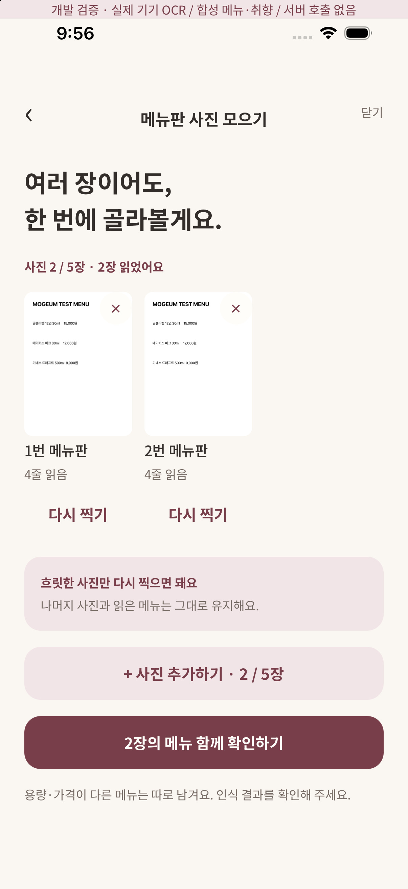
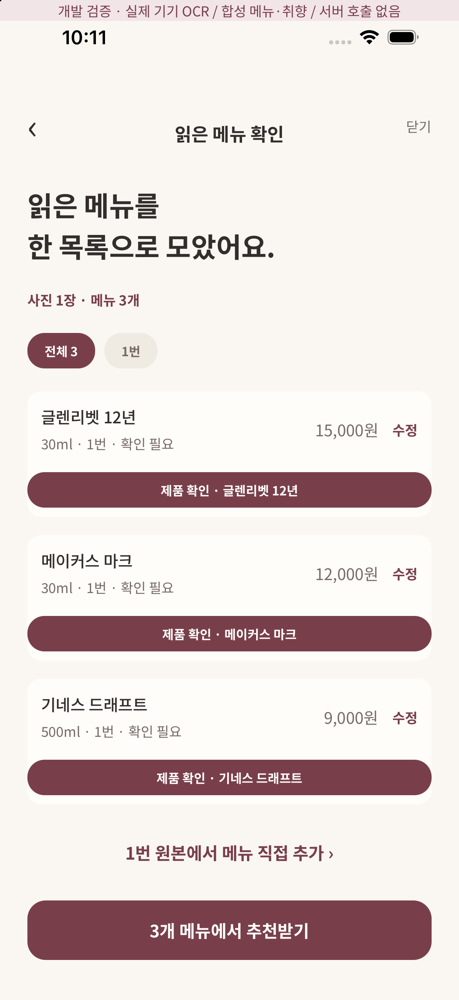
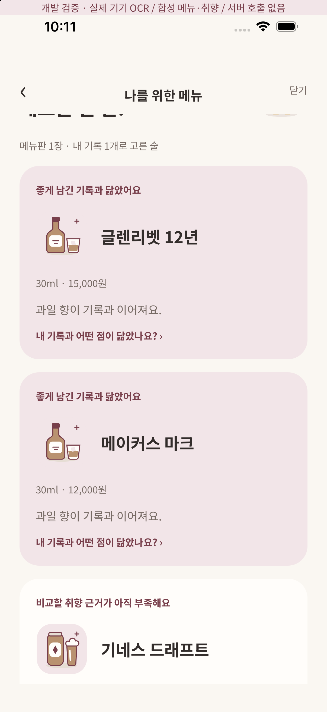
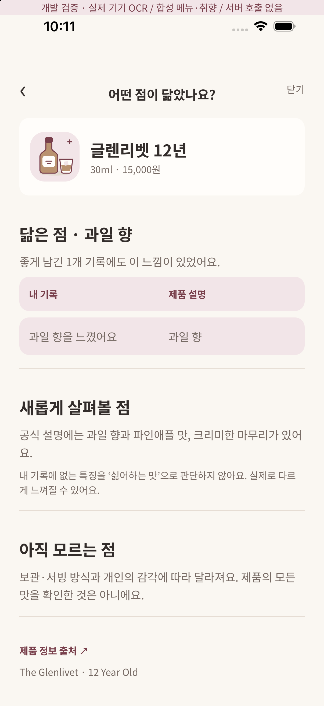
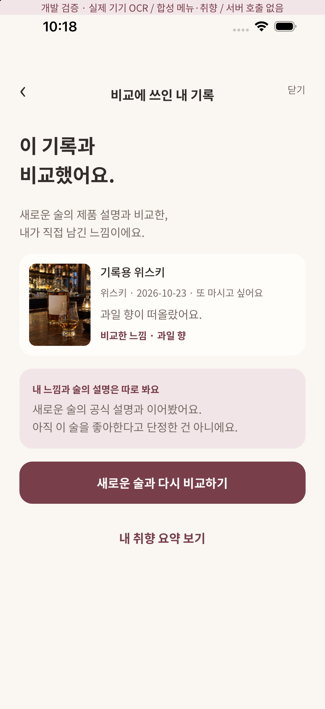
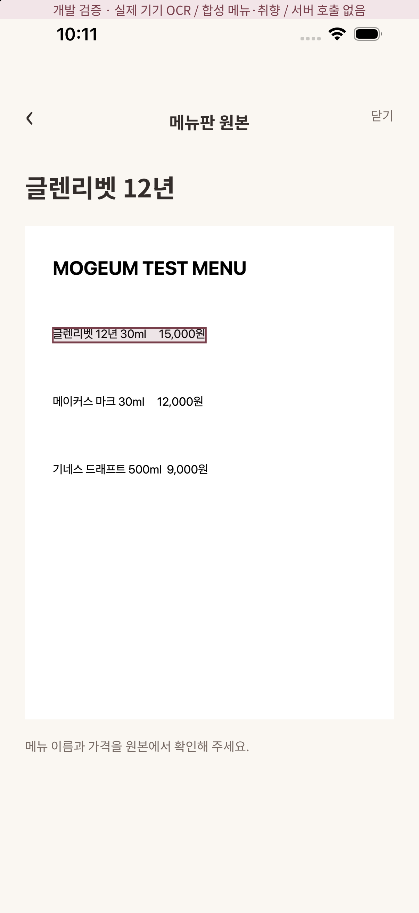
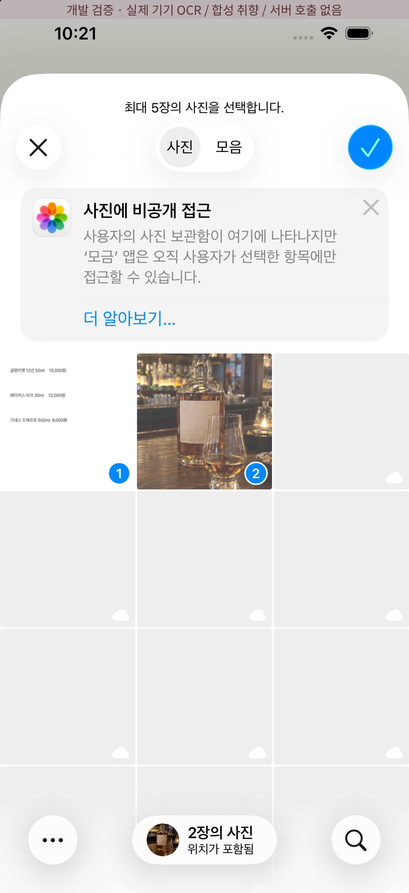
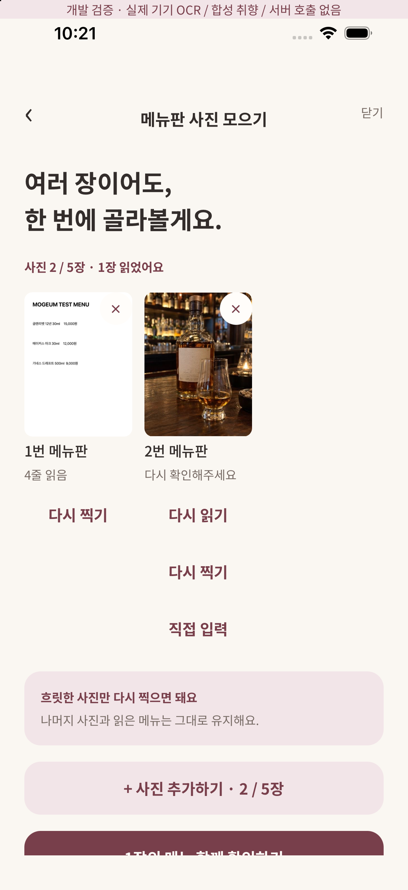
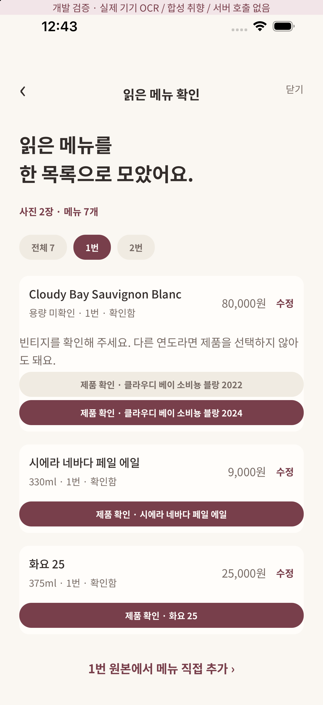
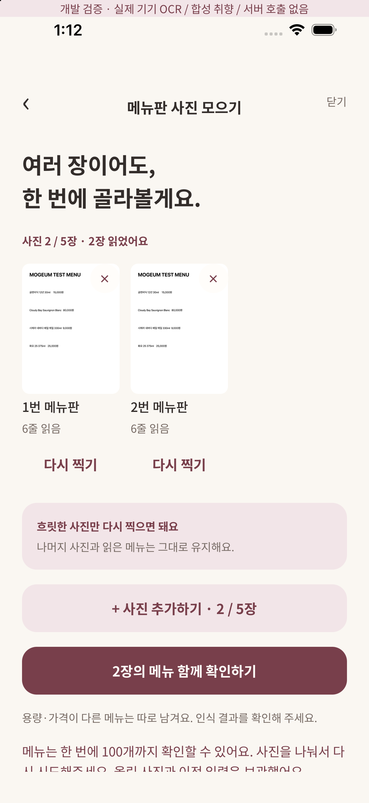

# 여러 장 메뉴판 → 내 취향과 비교

현재 카탈로그 확장: [32개 판본과 검증·배포 상태](../product-catalog.md). 아래 네이티브 실행 기록은 최초 메뉴 기능 검증 시점의 결과이며, 확장 카탈로그의 추가 화면 검증과 구분한다.

## 연결한 흐름
내 취향의 `메뉴판에서 내 취향 찾기` → 카메라/시스템 사진 선택기(최대 5장) → 사진별 기기 OCR → 통합 메뉴 확인/수정 → 제품 판본 확인 → 실제 기록 기반 비교 → 근거 기록/원본 위치 → 돌아가기.

사진은 기기에 보관하고 OCR 텍스트·좌표와 확인된 메뉴만 Supabase로 보낸다. 메뉴판 사진을 외부 AI에 자동 전송하지 않는다. 원 OCR과 사용자 수정 메뉴는 별도 필드다. 원본은 이 기기에만 있으므로 기기 변경 후 원본 동기화는 지원하지 않는다.

사진 ID와 imageRevision, 정규화된 4점 polygon, 원본 줄 ID를 함께 보관한다. 사진 추가/삭제/재촬영은 다른 사진을 지우지 않으며 이전 추천은 숨기고 다시 추천받는다. 재촬영한 사진의 예전 좌표는 사용하지 않는다. 처리 중단은 이후 작업/늦게 도착한 결과를 무효화한다. 이미 실행된 네이티브 인식 자체를 즉시 중단하는 API는 아직 없다.

앱 재실행 시 계정별 draft·사진·메뉴 확인 상태를 복구한다. 대기 중이던 사진은 다시 읽을 수 있다. 임시 저장이 완료된 뒤 불필요한 같은 세션의 사진 revision 파일을 정리한다. 저장 응답 유실 시 원래 요청을 먼저 재전송한 뒤 수정된 메뉴를 다음 revision으로 저장한다. 추천 결과는 영구 캐시하지 않고 현재 기록으로 다시 계산한다.

## OCR 엔진과 현재 한계
로컬 Expo 모듈 `modules/menu-ocr`를 사용한다. iOS는 Vision accurate ko-KR/en-US, Android는 bundled ML Kit Korean 16.0.1이다. 한국어/영문 혼용 메뉴의 초기 구현이며 ONNX 비교 실험이 끝났다는 뜻은 아니다. SDK의 실제 confidence만 사용하고 Android에서 제공하지 않는 값은 null이다. 사진의 방향을 정리한 뒤 긴 변 2200px 이하 JPEG로 준비하고 네이티브 결과의 실제 크기가 일치하는지 검사한다.

- [Apple Vision recognitionLanguages](https://developer.apple.com/documentation/vision/vnrecognizetextrequest/recognitionlanguages)
- [ML Kit Android Text Recognition](https://developers.google.com/ml-kit/vision/text-recognition/v2/android)
- [Expo local modules](https://docs.expo.dev/modules/get-started/)

20–30장 실메뉴판·저조도·기울어짐·회전·구형 기기 지연/메모리 평가와 ONNX 비교는 #10/#20에 남는다. 네이티브 빌드가 OCR 정확도 벤치마크를 대신하지 않는다.

## 서버와 추천 범위
`menu-recommend`는 Auth.getUser로 JWT를 검증한 뒤 동작한다. legacy-secret gateway 대신 함수 내부의 사용자 JWT 검증을 사용한다. 사용자가 보낸 userId는 사용하지 않는다. 입력은 최대 5장/100,000자/사진별 500줄/메뉴 100개이며 line ID·좌표·revision·제품 ID를 검사한다.

`parse`는 geometry-v1 규칙이다. 같은 줄에 있는 이름·원화 가격·명시적 용량을 보수적으로 분리한다. 연도/용량을 가격으로 만들지 않는다. 가격이 여러 개이거나 외화이면 가격을 확정하지 않는다. 다단·여러 가격·줄바꿈·가격 없는 메뉴는 사람이 원본을 확인하고 직접 추가/수정해야 한다. 동일 메뉴 중복을 자동 병합하지 않으며 수정 시 `이 메뉴 제외하기`로 제거할 수 있다. 추천받기 행동으로 목록 정보를 확인한다. 제품 후보는 정확히 맞을 때만 칩으로 선택하며 모르면 미확인으로 남긴다. 별칭은 제품 후보일 뿐, 정확한 판본은 사용자가 확인한다.

`recommend`는 **evidence-rules-v1**이다. Gemini를 호출했다고 표시하지 않는다. 현재 키 없이도 실제 서버에서 작동한다. 내 기록의 확정된 활성 v2 답변과 재음용/별점을 집계하고 출처가 있는 제품 특징과 겹치는 근거 ID만 반환한다. 사진만 있는 기록/모름/건너뜀은 맛 근거가 아니며 상반된 평가도 보인다. 인지한 향이 좋았던 술에 있었다는 것을 좋아한 원인으로 단정하지 않는다. 퍼센트 적합도는 만들지 않는다.

소스 카탈로그는 `product-catalog.ts`의 **32개 판본(주종별 8개)**으로 확장했다. 제조사 31개와 독립 심사기관 IWSC 1개를 구분하며 URL·확인일·판본·특징 근거를 보관한다. 다른 빈티지/도수/판본이나 미확인 제품은 맛을 추측하지 않는다. 빈티지 없는 와인은 확인 가능한 연도를 사용자가 선택한다. **관리형 서버는 재배포 대기 중이므로 아직 기존 4제품 범위**다. 상세 목록과 추가 iOS 검증은 [카탈로그 명세](../product-catalog.md)를 참조한다. 자동 제품 검색·추가 제품 확장·LLM 설명 작성과 실제 메뉴 벤치마크는 #12/#18/#20에 남는다.

제품 설명/닮은 점/새로 살펴볼 점/모르는 점을 구분한다. 근거 화면에는 실제 기록 사진·날짜·평가·확정 노트와 비교 특징을 표시한다. 사진은 소유권이 적용된 5분 signed URL로 조회한다. 근거는 record ID·revision으로 연결하며 기록 화면 복귀/앱 활성 시 현재 taste hash를 다시 확인한다. 바뀌거나 확인 실패하면 이전 추천을 숨긴다. 이름이 같은 과거 기록은 같은 제품으로 확정하지 않는다. 처음 마신 술이라는 표현 대신 내 기록 기준으로 설명한다.

`menu_sessions`는 owner RLS + 저장 RPC만 쓰기 허용, 최대 5장, revision 충돌/동일 요청 재시도를 처리한다. 이 표의 JSON은 모델 권한이나 제품 검증 근거가 아니며 Edge에서 모든 입력을 다시 검증한다.

## 디자인 근거와 검증 경계
Chrome에서 04 원본을 확인했다: 32(9:7760), 40(9:8329), 33(9:7820), 37(9:8109), 38(9:8163); 근거/원본은 39(9:8214), 41(9:8522) 흐름. 원본 400×868, content inset24, 기존 NotoSansKR/크림·버건디 tokens, Button/ChoiceChip/ScreenHeader/Mogu/주종 SVG를 재사용한다. 사진은 contain으로 종횡비를 유지한다. Figma MCP는 재인증 필요 상태여서 Chrome 원본을 기준으로 확인했다. 자동 픽셀 대조나 모든 상태의 원본 일치 완료를 주장하지 않는다. 서버 실패·미확인 제품·수동 입력은 구현 상태를 추가했다.

## 실행한 검증
- `npm run check`: 타입·린트·질문 계약·메뉴 도메인·DB/PGlite 테스트. 실제 관리형 HTTP 서비스가 없는 로컬에서 HTTP 테스트는 명시적으로 skip.
- 서버 Deno 2.9.6 check, `expo export --platform all` 빌드. 웹 브라우저로 앱 검증하지 않았다.
- iOS iPhone 17 Pro/iOS26.5 네이티브 빌드, 합성 메뉴판을 실제 Vision으로 읽어 한글 이름 3개·30ml/500ml·가격 3개 확인. 두 장 처리와 한 장 삭제 후 나머지 유지·앱 재실행 draft 복구 확인. 추천→제품 설명과 내 기록 비교→근거 목록, 원본의 실제 OCR polygon 강조→추천 이유 복귀도 확인했다. 시스템 PHPicker에서 합성 메뉴 사진과 기존 저장소의 술병 fixture 두 장을 실제 복수 선택했다. 메뉴 OCR 성공·술병 OCR 실패 시 성공한 사진/결과가 유지되고 개별 재시도·직접 입력 행동이 노출됨을 확인했다.
- Android ML Kit 모듈 compileDebugKotlin 및 앱 arm64-v8a assembleDebug 성공. Android OCR 실제 메뉴/화면·권한 E2E는 별도 검증이 남는다.
- CI는 일회용 실제 Supabase에서 migration→Auth→메뉴 해석→수정 저장/재시도→타 사용자 차단→확정 노트 근거 추천을 실행한다. 실행 링크/결과는 PR에 기록한다.
- 개발 프로젝트에 20261023030000 메뉴 DB migration 및 menu-recommend 함수 적용. 무인증/잘못된 JWT 401 응답 확인. CLI migration history 수동 적용 이력 정리는 기존 작업과 함께 남는다.
- 소셜 provider 미설정으로 사용자 계정의 iOS 로그인→실제 클라우드 추천 E2E는 아직 미검증이다. `dev/menu`는 개발 빌드 전용이며 합성 사진/취향·서버 미호출 배너가 있다. 실제 OCR을 수행하지만 서버 검증을 대신하지 않는다.

### iOS 화면 증거

`mogeum-dev://dev/menu?picker=1`은 서버 미호출의 합성 취향을 유지하면서 실제 시스템 사진 선택기를 사용하는 개발 검증 경로다. 사진 선택/OCR 결과를 고정 응답으로 대체하지 않는다. 저장소의 합성 메뉴와 술병 fixture만 선택하며 개인 사진은 테스트에 사용하지 않았다.

CI: [앱 검사/양 플랫폼 export](https://github.com/shinhanseo/mogeum/actions/runs/39883061757), [실제 PostgreSQL/Auth/메뉴 추천 통합](https://github.com/shinhanseo/mogeum/actions/runs/39883061792) 통과. 이후 로컬 임시 저장 실패 차단·picker 검증 경로 추가에 대한 최신 검사는 PR Checks에 표시된다.

## 메뉴 제외 의도 보존 · 2026-10-23

`이 메뉴 제외하기`는 해당 사진·imageRevision·OCR 줄 ID/원문에 연결한 로컬 제외 표시를 저장한다. 다른 사진을 추가하고 다시 해석하거나 앱을 재실행해도 해당 항목이 다시 살아나지 않는다. 동일 이름의 다른 사진/잔/보틀 항목을 이름만으로 삭제하지 않는다. 수동 입력은 목록에서 제거하며 OCR이 만들지 않으므로 별도 제외 표시가 필요 없다.

사진 삭제/재촬영 또는 OCR 원문 변경 시 오래된 제외 표시는 정리한다. 같은 줄 ID라도 원문이 달라졌으면 새 메뉴를 숨기지 않는다. 재인식 결과가 달라졌으면 오래된 수정 값을 새 OCR에 붙이지 않고 다시 확인한다. 일시적 OCR 실패에서는 사진 판본이 유지되는 동안 제외 의도를 보관한다. 유효한 원문을 찾지 못하면 제외 저장을 성공한 것으로 처리하지 않고 기존 항목과 오류 안내를 유지한다.

제외 표시는 기기·계정별 draft에만 둔다(최대 500개). 서버 저장에는 최종 확인 메뉴만 전달하며 기존 pendingSave의 정확한 재시도 payload를 바꾸지 않는다. 다른 기기로 제외 의도가 동기화되는 기능은 아니다. 원문 OCR은 수정하거나 삭제하지 않는다. 구형 draft에 exclusions가 없어도 복구하고, 잘못된 제외 metadata 때문에 사진/입력 전체를 버리지 않는다.

검증: 자동 회귀 8개(제외/수정 보존·다른 사진/판매 단위·재촬영·원문 변경·실패/수동 입력·JSON 복구). iOS 26.5/iPhone 17 Pro의 개발 전용 합성 메뉴를 실제 Vision으로 읽어 4개→1개 제외→두 번째 4개 메뉴 사진 추가→재분석 7개→앱 종료/재실행→재분석 7개를 확인했다. 첫 사진 필터에는 3개가 남고 두 번째 사진의 같은 술은 유지된다. 개발용 합성 취향/서버 미호출 배너 경로이며 관리형 서버 검증을 대신하지 않는다. 기존 화면/컴포넌트/레이아웃을 변경하지 않았다. Android 추가 런타임 확인은 남는다.

## 100개 초과 메뉴 처리

메뉴 해석 결과가 세션 전체에서 100개를 넘으면 MENU_ITEM_LIMIT 오류를 반환한다. 뒤의 항목을 slice로 조용히 잘라 일부 추천을 전체 메뉴 결과처럼 표시하지 않는다. 정확히 100개는 모두 유지한다. 앱은 허용된 이 코드만 안전한 한도 안내로 바꾸고 사진을 나눠 처리하도록 안내한다. 기존 사진/OCR/수정 입력을 지우지 않는다. 원문 서버 예외 문구는 노출하지 않는다.

경계 100/101개, 여러 사진 합계, 입력 원문 불변 회귀 3개와 실제 HTTP의 101개 입력→400/명시적 코드 검증을 추가했다. iOS는 개발용 failure=capacity 경로에서 오류를 주입해 안내와 기존 사진2장/OCR 보존을 확인했다. 이 기기 확인은 101줄짜리 실메뉴 OCR 정확도 측정이 아니다. 해당 신호를 반환하려면 관리형 Edge 함수 재배포가 필요하며 현재 브라우저 비활성화로 대기 중이다.

현재 양 플랫폼의 실제 네이티브 OCR 실행 증거는 [합성 메뉴 14종 baseline](native-ocr-benchmark.md)에 있다. Android는 개발 경로 자동 실행으로 ML Kit 호출과 결과를 확인했으며, 기존의 Android 화면/권한 E2E 미검증과 구분한다. 두 열 가격 연결과 iOS 경계 좌표 실패를 재현했고 후속 수정을 진행한다.
