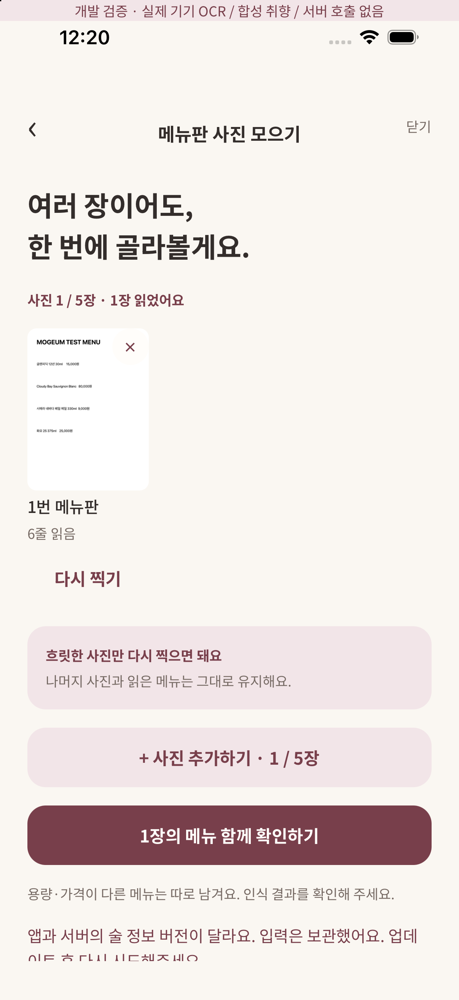

# 메뉴 추천 품질과 응답 계약

## 이번 구현

앱은 해석/추천 응답의 catalogVersion을 먼저 확인한다. 업데이트되지 않은 서버와 앱의 제품 목록이 다르면 입력을 보관하고 오류로 안내한다. parse에는 catalogVersion을 추가했으므로 기존 서버에 이번 앱을 연결하면 해석부터 차단된다. 앱과 Edge 함수를 함께 배포해야 한다.

추천 응답은 화면에 보이기 전에 다음을 검사한다.

- 확정 메뉴당 결과가 정확히 하나이고 원래 메뉴 집합 밖의 ID가 없음.
- 메뉴 이름의 후보 집합과 제품 ID가 일치함.
- 닮은 특징과 나머지 특징이 해당 제품 출처 카탈로그에 실제 존재함. 없는 향·문구·누락/중복 특징은 거부.
- 근거 ID가 반환된 실제 근거 목록에 있고 중복/양쪽 평가 겹침이 없음. 명시적으로 부정/중립 평가한 기록을 긍정 근거로 뒤집지 않음.
- 제품·근거·상태·점수가 서로 일치하며 같은 기록/차원의 중복 점수가 없음.
- 빈 근거·미확인 제품·기존에 좋게 기록한 술의 정상적인 결과도 허용.
- 기록 필드 크기·revision·카탈로그 크기·지원 메서드를 검사함.

이 클라이언트 검사는 소유권 증명이 아니다. 소유권은 검증된 사용자 JWT와 RLS로 서버에서 제한하고 실제 Supabase HTTP 테스트에서 타 계정 격리를 확인한다. 원문 답변의 감각이 맞는지나 취향의 원인을 클라이언트가 새로 추정하지 않는다.

## 자동 평가

`npm run test:menu-quality`로 제품/메뉴 도메인과 결과 계약을 함께 검사한다. `npm run check`에도 동일 테스트가 포함된다. `tests/fixtures/menu-quality.ts`는 4주종의 light/deep 실제 질문 코드를 사용한 합성 관측이다. 개인정보·개인 원문 사진·메모·토큰은 없다.

가볍게/자세히 8조합, 사진만 저장·모름·건너뜀·중립·부정·낡은 답변·등록되지 않은 지시문 descriptor, 상반된 선호를 포함한다. 조작된 메뉴·제품·향·문구·근거·중복·점수·상태·버전과 잘못된 카탈로그 크기를 거부한다. 실제 Supabase HTTP 검사에도 이 클라이언트 validator를 실행해 서버의 정상 응답이 통과하는지 확인한다.

규칙 기반 추천의 결정적 회귀 검사다. 실메뉴 OCR 정확도/지연 벤치마크나 실제 LLM 품질·환각률 평가 결과로 해석하지 않는다. 외부 모델 호출과 비용은 0이며 Gemini smoke는 키 부재로 미실행이다. #20은 닫지 않는다.

## iOS 오류 복구 확인

iPhone 17 Pro / iOS 26.5의 `mogeum-dev://dev/menu?catalog=1&failure=catalog`에서 합성 메뉴를 실제 Vision으로 읽은 뒤 의도적으로 카탈로그 불일치 오류를 발생시켰다. 기존 사진과 OCR 상태가 남고 재시도 행동이 유지되며, 버전 차이와 입력 보관을 안내함을 확인했다. 개발 전용 배너/합성 취향/서버 미호출 경로다. 이 화면은 기존 오류 영역의 문구를 사용하며 Figma 신규 상태 일치 검증을 주장하지 않는다.

## 배포·남은 검증

관리형 menu-recommend 함수 배포는 로컬 브라우저 제어 비활성화로 대기 중이다. 개발 서버에는 이전 4제품 함수가 남아 있다. 사용자 소셜 로그인/실제 클라우드 iOS E2E와 Android 추가 런타임, 실메뉴 20–30장 평가가 남는다. CI와 로컬 실행 결과는 PR을 참조한다.
