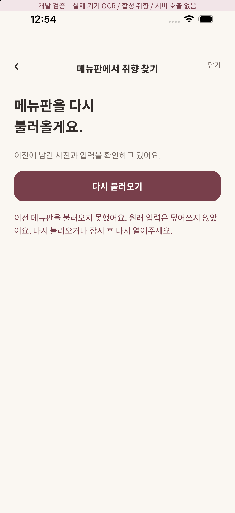
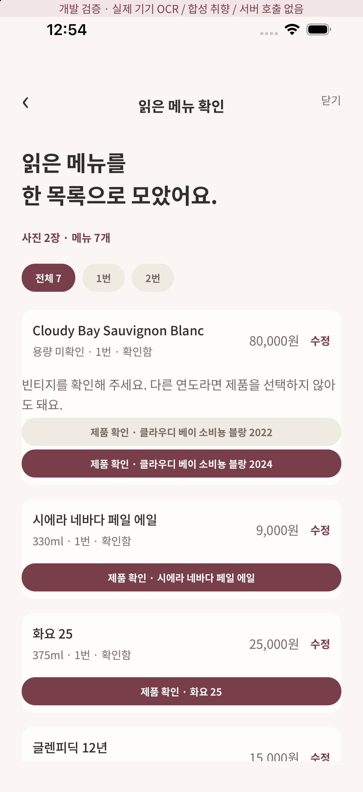

# 메뉴판 임시 저장 읽기 실패 보호

## 달라진 동작

이전에는 저장소 읽기/JSON/파일 확인 오류를 모두 null로 반환해 빈 세션과 구분하지 못했다. 새 사진을 추가하면 이전 draft key를 덮을 수 있었다. 이제 empty/ready/failed를 구분한다. failed일 때 새 입력 화면 대신 원본 보존 안내와 다시 불러오기를 제공하며 정상 복구 전에는 draft 쓰기와 사진 추가를 진행하지 않는다. 유효하지 않은 저장을 자동 삭제하거나 빈 값으로 덮지 않는다.

- 계정·세션 경로, UUID, 사진 판본/크기, OCR 참조, 메뉴 자료형·크기, 중복 ID, pending revision/원문 연결을 검사한다.
- 구형 draft에 제외 metadata가 없어도 복구한다. 잘못된 제외 metadata만 정리하고 사진/입력 전체를 버리지 않는다.
- 현재 카탈로그에서 확인할 수 없는 제품 선택은 해제하고 재확인 대상으로 둔다. 이름·가격·용량은 보존한다.
- 파일 확인 API 자체 실패는 전체 읽기 실패로 두어 재시도한다. 파일이 실제로 없는 경우 사진을 실패 상태로 표시하고 기존 입력은 유지한다. 없는 OCR을 만들어 넣지 않는다.
- 비동기 복구 요청은 generation으로 구분하고 닫힌 화면/계정 전환의 늦은 응답을 게시하지 않는다. 실제 route는 사용자 ID key로 컴포넌트를 분리한다.
- 로컬 draft 읽기/쓰기 크기는 최대 16,000,000자로 제한한다. 한도 초과 원본도 지우지 않는다.

## 불확실한 저장 요청과 제품 확인의 구분

pendingSave는 이미 서버가 수신했을 수 있으므로 현재 카탈로그가 바뀌어도 내용과 revision을 바꾸지 않고 재전송한다. 저장 transport는 bounded opaque product ID를 허용하지만 이것이 검증된 제품 정보는 아니다. 최종 추천 요청에서는 서버가 현재 카탈로그와 메뉴 이름의 후보 집합을 다시 검사한다. 모르는/잘못 연결한 ID로 추천할 수 없다. DB 세션 JSON은 제품 검증 권한이나 모델 입력의 신뢰 근거가 아니다.

## 실행 검증과 한계

- tests/menu-restore.test.ts: 읽기 오류/실제 빈 상태, 재시도, JSON/파일 API 실패, 수정 보존, 카탈로그 변경+pending 그대로 유지, 계정 경로/사진·줄·판본/중복/크기/revision 검사 등 19개 합성 회귀.
- 실제 Supabase HTTP CI에 오래된 opaque 제품 ID 저장→동일 요청 재전송→추천 거부를 추가했다. 최종 실행 결과는 PR Checks를 참조한다.
- iPhone 17 Pro/iOS26.5의 개발용 `dev/menu?catalog=1&failure=restore`: 한 번의 읽기 실패를 의도적으로 주입하고 새 사진 입력이 노출되지 않음→다시 불러오기→기존 실제 Vision 합성 메뉴 사진 2장→재분석 메뉴 7개/기존 수정·제외 복구를 확인했다. 서버 미호출/합성 취향 배너 경로다.
- 복구 안내는 기존 ScreenHeader/Button/타이포·간격 토큰을 사용한 신규 오류 상태다. 브라우저/Figma 접근 비활성화로 이 신규 상태의 원본 일치를 검증했다고 하지 않는다.
- Android Studio를 열어 Running Devices 진입을 시도했으나 CUA가 Java 메뉴를 invalid UI element로 처리하고 스크린샷도 제공하지 않았다. Android 실제 OCR/화면 E2E는 성공으로 보고하지 않는다. APK와 ML Kit 빌드 성공 기록과 구분한다.
- 잘못된 JSON/유실 파일을 자동 복원하는 기능이 아니다. 원본이 계속 손상된 경우 다시 불러와도 실패하며 데이터는 보존한다. 자동 초기화/원본 폐기 행동은 추가하지 않았다.
- 관리형 서버 배포는 로컬 브라우저 제어 비활성화로 여전히 대기 중이다. 소셜 로그인/Gemini 설정도 별도 미완료다.

