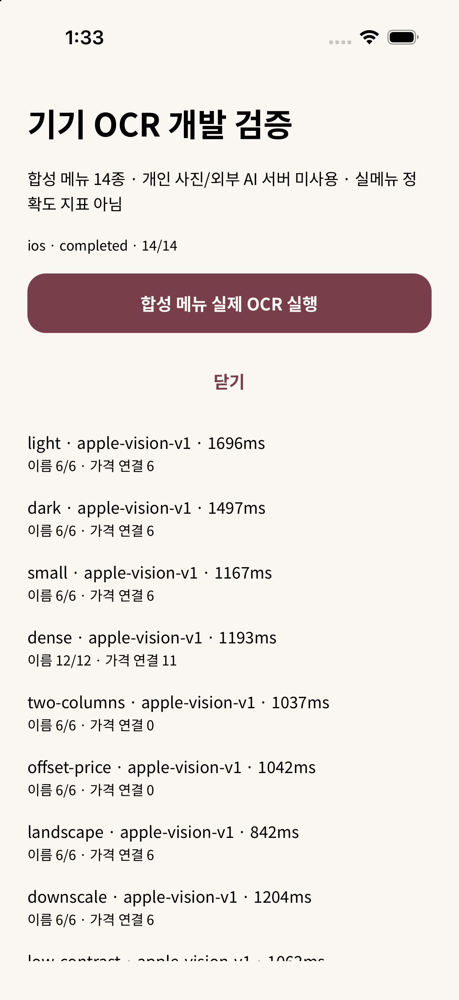

# 네이티브 OCR 합성 메뉴 14종 실행

2026-10-23 개발 빌드에서 실제 Apple Vision과 bundled ML Kit Korean을 실행했다. iOS는 iPhone 17 Pro/iOS26.5 Simulator, Android는 Pixel 7 AVD/Android17(API37) arm64 환경이다. Android는 개발 전용 deep link로 자동 실행하고 앱 sandbox의 검증 보고서만 읽었다. Android 화면 터치/권한 전체 E2E를 확인한 것은 아니다.

개인 사진·메모·토큰을 사용하지 않았다. Swift/AppKit으로 새로 그린 14개 합성 메뉴만 사용하며 가격은 검증용 가상 값이다. 외부 AI/추천 서버를 호출하지 않는다. 합성 메뉴 결과를 실제 술집 메뉴 정확도나 20–30장 실메뉴 평가 완료로 해석하지 않는다.

## 측정 범위

- prepareMs에는 로컬 fixture HTTP 다운로드와 실제 앱 사진 준비/축소가 포함된다.
- ocrMs는 네이티브 인식과 앱 OCR 계약 검증까지의 단일 관측이다. 실패한 계약에서는 시간이 미집계될 수 있다. 파서 시간은 별도다. 반복 분포/실기기 p95/메모리/배터리 실측이 아니다.
- 이름 포함 수는 정답 이름의 정규화된 문자열이 네이티브 결과에 얼마나 나오는지다. 글자 오류율(CER)이 아니며 줄바꿈·읽는 순서에 영향을 받는다. 중복 이름은 실제 발견 개수만 센다.
- 가격 연결은 파싱된 이름과 숫자 가격이 정답과 동시에 맞는 항목 수다. 원문 통화 기호가 정확했는지까지 보장하는 지표가 아니다. 퍼센트/단위 OCR 오류는 후속 보수적 해석 과제다.
- 가격 없음/다음 줄 가격/복수 가격은 강제로 원화 가격을 확정하지 않는지를 별도로 본다.

## 실행 결과 (수정 전 baseline)

| 합성 조건 | 항목 | iOS 이름 / 가격 연결 / OCR ms | Android 이름 / 가격 연결 / OCR ms |
| --- | ---: | --- | --- |
| 밝은 배경 | 6 | 6 / 6 / 1696 | 5 / 3 / 140 |
| 어두운 배경 | 6 | 6 / 6 / 1497 | 5 / 5 / 103 |
| 작은 글씨 | 6 | 6 / 6 / 1167 | 6 / 4 / 139 |
| 촘촘한 12항목 | 12 | 12 / 11 / 1193 | Call to function 'ExponentFileSystem.copyAsync' has been rejected.
→ Caused by: java.io.FileNotFoundException: Source '/data/user/0/com.example.mogeum.dev/cache/ImageManipulator/c8b903b1-13f4-467a-be7 |
| 두 열 메뉴 | 6 | 6 / 0 / 1037 | 5 / 0 / 111 |
| 가격이 다음 줄 | 6 | 6 / 가격 확정 0 / 1042 | 5 / 가격 확정 1 / 210 |
| 가로 메뉴 | 6 | 6 / 6 / 842 | 6 / 5 / 166 |
| 큰 원본 축소 | 6 | 6 / 6 / 1204 | 6 / 4 / 294 |
| 약한 대비 | 6 | 6 / 6 / 1062 | 5 / 5 / 162 |
| 세리프 영문 | 6 | 6 / 5 / 1100 | 5 / 3 / 150 |
| 줄바꿈 이름 | 6 | 6 / 3 / 1040 | 5 / 2 / 146 |
| 8도 기울임 | 6 | INVALID_LINE | 6 / 0 / 117 |
| 가격 없음 | 6 | 6 / 가격 확정 0 / 1023 | 5 / 가격 확정 0 / 127 |
| 잔·병 두 가격 | 6 | 6 / 가격 확정 0 / 1097 | 5 / 가격 확정 0 / 130 |

원본 보고서에는 실제 엔진 버전·원문·confidence·polygon·메트릭이 포함된다: [iOS baseline](ocr-benchmark/ios-baseline-v1.json), [Android baseline](ocr-benchmark/android-baseline-v1.json). 원문은 모두 이 저장소의 합성 메뉴다.

## 재현된 문제

1. 양 엔진 모두 두 열 메뉴의 원문을 읽지만 현재 geometry-v1 파서가 같은 높이의 두 판매 항목을 한 행으로 합친다. 각 열을 분리하지 못해 가격 연결이 0개다.
2. iOS 기울임 fixture의 제목 한 꼭짓점 x=-0.0048546이 나와 strict 좌표 검사에서 사진 전체가 INVALID_LINE이 됐다. 실제 제품 이름과 가격은 읽었지만 계약에서 막힌 사례다. Android는 adapter에서 이미 화면 범위로 clip한다. 좌표 처리 수정을 별도 진행한다.
3. Android에서는 원화를 %나 l로 읽는 사례와 일부 한글 오독이 있다. 없는 이름/가격/통화를 추정해 채우지 않고 사용자 확인과 보수적 처리로 연결해야 한다.
4. 줄바꿈 이름, 촘촘한 행, 기울임에서 단일 행 파서의 한계가 보인다. 엔진 변경이나 ONNX 채택을 완료했다고 보지 않는다.

## 다시 실행

macOS에서 `swift scripts/generate-ocr-fixtures.swift assets/fixtures/ocr-benchmark`로 새 raster fixture를 생성한다. 이미지는 프로덕션 코드의 static require로 참조하지 않아 앱에 포함하지 않는다. manifest만 작게 import한다.

`python3 -m http.server 8765 --bind 127.0.0.1 --directory assets/fixtures/ocr-benchmark`로 이 공개 합성 폴더만 serve한다. Android는 `adb reverse tcp:8765 tcp:8765`와 Metro 8081 reverse가 필요하다.

개발 빌드에서 `mogeum-dev://dev/ocr-benchmark?run=1&runId=ios-baseline-v1` 또는 Android용 runId로 실행한다. 보고서는 앱 documentDirectory의 `ocr-benchmark-<runId>.json`이다. __DEV__가 아니면 route는 홈으로 이동하고 OCR을 실행하지 않는다. 이 route는 사용자 기능·백엔드 검증을 대신하지 않는다.

실제 카메라/사진 선택 권한, 여러 장 UI 조작, 실메뉴·저조도 사진·물리 기기 메모리/지연, ONNX 비교는 남는다. 관리형 함수 배포와 소셜 로그인/Gemini 설정도 기존 미완료 상태다. #10/#20을 닫지 않는다.

프로덕션 양 플랫폼 export에서 fixture PNG와 동일한 바이트 hash를 가진 파일은 0개였다. 개발용 PNG는 localhost fixture 서버로만 읽고 앱 코드에는 이미지 require를 두지 않았다. iOS 개발 검증 화면:

## iOS 좌표 정규화 수정 — apple-vision-v2

같은 iPhone 17 Pro/iOS26.5 Simulator에서 네이티브를 재빌드하고 14종을 다시 실행했다. [수정 후 원본 보고서](ocr-benchmark/ios-normalized-v2.json)의 모든 케이스가 apple-vision-v2이며 invalidPoints=0, OCR/계약 오류=0이다. 기울임 제목의 음수 꼭짓점 때문에 사진 전체가 실패하던 문제는 해소됐다. 네이티브 adapter가 유한 좌표를 이미지 경계 [0,1]로 clip한다. 비유한 꼭짓점의 observation은 제외하고 서버의 엄격한 입력 검사는 유지한다. 기존 apple-vision-v1 입력도 계속 허용한다.

이는 기울임 메뉴의 가격 연결 해결을 뜻하지 않는다. 해당 케이스는 이름 6/6이 읽히지만 geometry-v1 가격 연결은 0/6이고 두 열 메뉴도 0/6이다. 후속 파서 개선 대상이다. 실메뉴·물리 iPhone 측정은 남는다. 관리형 menu-recommend에도 v2 엔진 허용 변경을 배포해야 새 네이티브 입력을 받을 수 있다. 아직 관리형 서버 배포를 완료하지 않았다.

재실행 중 legacy background download가 unknown error로 실패해, 개발용 fixture 다운로드에 foreground session을 지정하고 앱을 완전히 재시작했다. iOS는 localhost, Android는 reverse된 127.0.0.1을 사용한다. 실패 실행은 OCR 성공으로 집계하지 않았고 공개 보고서는 완료된 v2e 실행만 보관했다. 운영 사진 다운로드나 ATS 설정은 바꾸지 않았다.

## geometry-v2: 두 열 분리와 잘못 읽힌 통화 제외

양 플랫폼에서 같은 14종을 실제 native OCR부터 다시 실행했다. [iOS](ocr-benchmark/ios-geometry-v2.json), [Android](ocr-benchmark/android-geometry-v2.json). 두 열 메뉴 가격 연결은 iOS 0→6/6, Android 0→2/6이다. 분리는 각 이름 다음에 명시적인 가격 줄이 있고 열 사이 여백이 있는 완결된 경우에 한정한다. 각 항목은 자기 열의 source line ID만 갖고, 같은 술의 잔/병 복수 가격은 한 항목의 모호한 가격으로 유지한다.

Android의 %/l 오독을 원화로 해석하지 않도록 보수적으로 처리해, 새 실행의 밝은 배경 연결은 2/6·어두운 배경 3/6·작은 글씨 2/6이다. 숫자만 정답과 같아 기존 지표가 성공으로 세던 잘못된 통화 인식은 더 이상 가격으로 사용하지 않는다. 이름·통화를 복원해 만들어 채우지 않으며 원문은 수정 화면에 남는다. 이 수치를 엔진 정확도 향상으로 해석하지 않는다.

기울임과 다음 줄 가격은 양 플랫폼 모두 가격 확정 0개로 남는다. 가격 없음·잔/병 복수 가격도 확정 0개를 유지했다. Android dense는 이번 실행에서는 오류 없이 12항목 중 가격 연결 7개였다(이전 baseline에는 준비 파일 copy 오류가 있어 그대로 보관). 실메뉴·물리 기기 검증은 남는다. geometry-v2는 함수 배포 후 서버 경로에도 적용된다.

## 메뉴 사진 임시 파일 수명

사진 변환 방식과 OCR 결과를 유지한 임시 파일 정리 검증은 [별도 보고서](menu-photo-cache.md)에 있다. 양 플랫폼 14종에서 원본 보존/새 잔여 임시 파일 0을 확인했다. 후속 보고서부터 photoPipeline 식별자와 준비 직후 파일 보존/잔여 수를 남긴다.

## Galaxy S24 실제 기기 · 모호한 두 가격 보강 (2026-10-26)

연결된 SM-S921N / Android API36에서 저장소 합성 메뉴판14종을 실제 ML Kit로 읽었다. 개인 사진·서버·사용자 기록은 사용하지 않았다. [수정 전](ocr-benchmark/android-galaxy-20261026.json), [수정 후](ocr-benchmark/android-galaxy-20261026-fixed.json). 두 실행 모두14종 완료·실행 오류0이며 수정 후 OCR 호출 최대169ms였다(이 표본의 측정이며 일반 지연 보장이 아니다).

잔·병 두 가격 이미지에서 `12,000% / 150,000`, `9,000 | 150,0002`처럼 통화/숫자가 손상되면 정상 가격 필터가 하나만 남겨 잘못 확정했다. 필터 전 쉼표 금액 힌트를 검사해 금액이 복수이거나 접미사가 손상됐으면 price=null로 남긴다. 불확실한 후보와 원문 위치는 유지하고 제품/메뉴를 자동 확정하지 않는다. 단일 정상 원화·통화 접두 가격은 유지한다.

모호한 가격 케이스 abstentionViolations4→0, 나머지13종의 집계 지표는 동일했다. 실제 네이티브 OCR 원문과 경계를 고정한 회귀 및 손상된 두 가격/정상 단일 가격 검사를 추가했다. check342개 중334개 통과/환경 의존8개 skip. 현재 앱에는 반영됐으며 관리형 menu-recommend 재배포가 필요하다. 실제 식당 사진·카메라 권한 UI·iPhone 물리 기기 확인은 별도다.
