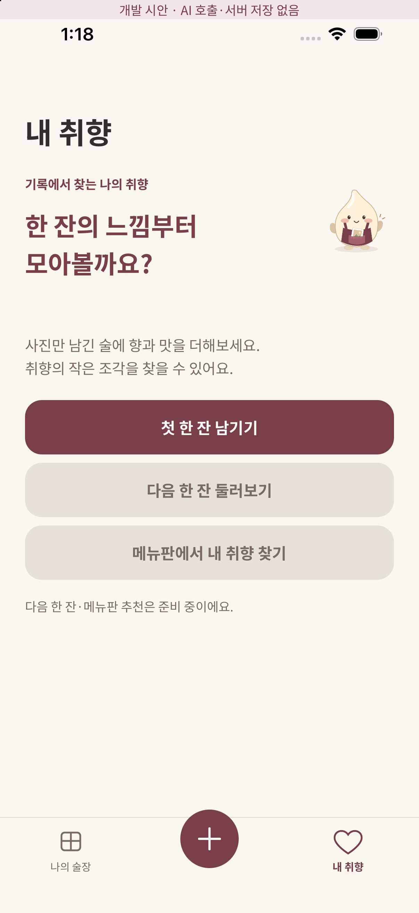
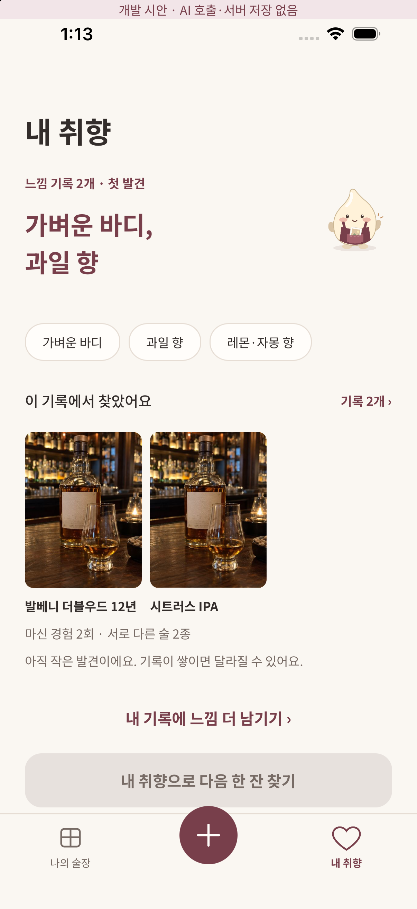
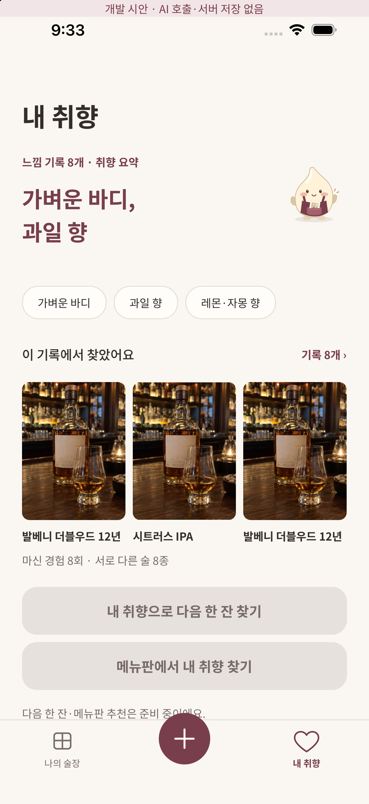
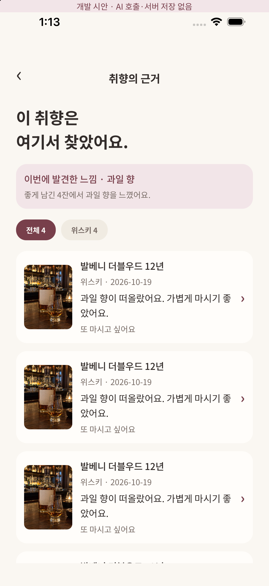
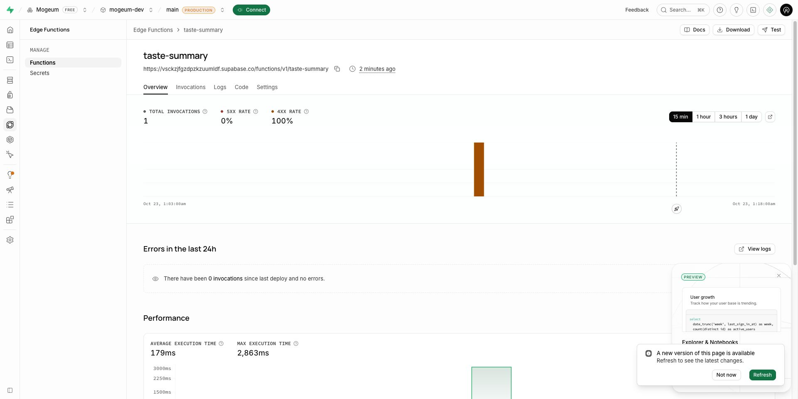

# 내 기록 기반 취향 요약

## 흐름
내 취향 탭 → 자신의 현재 기록 context → 확정된 활성 v2 답변/평가 집계 → AI 요약 요청 → 근거 칩/사진 → 현재 근거 목록 → 실제 경험 상세. 기존 캐시는 동일 hash일 때만 표시하며 탭 진입마다 모델을 부르지 않는다. 기록이 바뀌면 기존 주장은 숨기고 갱신 행동을 표시한다.

사진/이름뿐인 기록, 평가 미상, 미확정·구 catalog·비활성 모드·모름/건너뜀은 선호 근거가 아니다. 기본 재음용 의사가 우선이며 없을 때만 4–5점/1–2점을 전체 긍정/부정 신호로 사용한다. 지각한 향이 긍정적 술에 있었다는 사실을 해당 향을 좋아한 원인으로 단정하지 않는다. 향의 달콤함은 단맛과 별도다. 동일 술 8회는 술 8종이 아니며 5개 이상이어도 서로 다른 술 3종 미만이면 축적 단계로 승격하지 않는다.

AI가 임의 감각 문장을 생성하도록 하지 않는다. 코드가 만든 특징/근거에서 1–3개를 고르게 하고 기존 ID·중복·긍정 근거를 검사한 뒤 고정 표현으로 표시한다. 상반된 평가는 별도 근거로 남긴다. 사진·원문 메모·제품 이름/ID는 모델에 보내지 않는다. 현재 특징 분석은 구조화 선택 답변만 지원하며 자유 서술의 감각 추출은 지원하지 않는다.

## 서버
supabase/functions/_shared에 순수 집계·입출력 handler, taste-summary에 실제 Gemini adapter/Edge entry를 둔다. AI SDK7.0.148, Google4.0.102, Zod4.6.7을 별도 서버 package와 Deno lock으로 고정했다. 앱 의존성에는 추가하지 않았다. Deno check 통과. 현재 기본 모델은 공식 문서에서 확인한 gemini-3.8-flash이며 GEMINI_MODEL로 바꿀 수 있다.

사용자 JWT는 Auth 서버 getUser로 검증한다. service_role은 서버 lease/cache RPC만 실행한다. DB의 private table은 RLS와 직접 권한 철회. 캐시/read와 완료 시 현재 전체 revision hash를 비교한다. 임의 client userId/근거 입력을 거절한다. 하루 5회·20초 간격·90초 lease·25초 모델 timeout·자동 재시도 없음.

## 외부 설정
사용자가 Gemini 키가 아직 없다고 확인했다. `GOOGLE_GENERATIVE_AI_API_KEY`를 Supabase Dashboard → Edge Functions → Secrets에 사용자 본인이 저장하면 된다. 채팅/EXPO_PUBLIC_/Git에 넣지 않는다. 새 결제/요금제 변경은 하지 않았다. 키 미설정이면 503 AI_NOT_CONFIGURED, 앱은 사용 불가/기록 보존 안내를 표시한다. 실제 Gemini 호출·출력 품질/비용은 아직 검증하지 않았다.

## 검증
로컬 타입/린트/카탈로그 계약/도메인/DB 테스트와 Deno 함수 타입 검증. 0/2/8개·동일 술 반복/다양성·모드/확정 revision·상반된 평가·근거 없는 ID·중복/자유 문장 출력 거절·인증/키 미설정·캐시/lease/오래된 완료 차단을 검증한다.
CI는 실제 PostgreSQL 마이그레이션/정책과 실제 JWT→context→로컬 Edge Function→키 미설정 응답/잘못된 JWT 거절을 실행한다. 실제 provider 호출 성공을 대신하는 mock 결과는 운영 경로에 없다.

## UI와 제한
iOS native /dev/taste?count=0/2/8 및 evidence는 명시적 fixture이며 AI 호출·서버 저장 없음 배너를 표시한다. 사용자 경로에는 예시 기록/분석을 넣지 않는다. 실제 소셜 provider 설정이 없어 실제 사용자 iOS 저장→AI 생성 전체 흐름은 남았다. Android 실기기·글자 확대·실제 Gemini 품질 평가는 별도다. 원본 피그마 28/29/31을 Chrome으로 확인했으며 자동 레이어 추출이 막혀 픽셀 일치 완료로 주장하지 않는다.

공식 근거: [Gemini 모델](https://ai.google.dev/gemini-api/docs/models/gemini-3.8-flash), [Google SDK](https://ai-sdk.dev/providers/ai-sdk-providers/google), [Supabase 인증](https://supabase.com/docs/guides/functions/auth).

## 최종 검증 증거 · 2026-10-23
- 코드 commit `68e14d2`: [App checks](https://github.com/shinhanseo/mogeum/actions/runs/39812483772) success. 타입/린트/계약/71 tests(69 pass, 2 local-service skip), 의존성 검사, iOS·Android·web export.
- 같은 코드의 [Database policies](https://github.com/shinhanseo/mogeum/actions/runs/39812483860) success. 실제 PostgreSQL 마이그레이션/소유권/캐시 lease 및 실제 JWT→Edge Function 키 미설정503/잘못된 JWT401 확인.
- Deno2.9.6의 실제 서버 index/provider 타입 검사 통과. 개발 프로젝트에 DB 및 최종 함수를 배포했고 익명/잘못된 토큰 요청에서 `UNAUTHENTICATED` HTTP401 응답을 확인했다. CLI 인증 토큰이 없어 Dashboard에 동일 SQL/번들을 입력했고 붙여넣기 코드 일치를 확인했다. 기존 수동 마이그레이션의 CLI history repair는 남아 있다.
- iPhone17Pro iOS26.5 native: 0/2/8 기록, 원본 모구/버건디·크림/세로 사진/공통 하단 탭, 칩→근거 목록, 전체/맥주 필터, 원문 감상 표시와 줄바꿈 확인. 실제 분석 결과가 아닌 명시적 fixture다. 사진은 허가된 동일 Figma 테스트 사진을 재사용하며 다양한 실제 제품 사진/모델 품질의 증거가 아니다.

이 검증 이후 커밋은 문서·스크린샷만 추가한다. 실제 Gemini 응답은 키가 없어 검증하지 않았고 이슈 #13/#11의 전체 완료로 처리하지 않는다.
