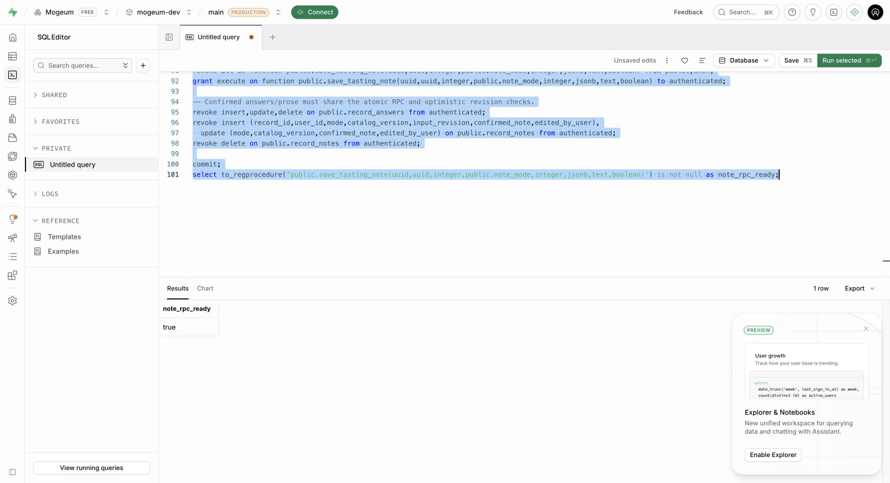

# 테이스팅 노트 구현·검증 · 2026-10-22

브랜치 `feat/6-tasting-answers`, PR #33. #6/#27 전체 완료 표시가 아니다.

## 연결한 흐름

기본 정보·재음용 의향·선택 별점 → 기본 기록 저장 성공 → 첫 기록 방식 시트(주종 재선택 없음) → 가볍게/자세히 질문 → 선택 답변의 문장 미리보기 → 직접 수정/취소 → 같은 record ID에 원자 저장 → 술장 재조회.

이후 새 노트는 실제 저장한 마지막 모드를 사용한다. 기존 v2 노트를 열면 해당 노트 모드와 두 모드의 답변을 ID 기준으로 읽는다. 모드 전환은 양쪽 draft를 보존하되 현재 모드/활성 조건만 확정 입력에 사용한다. 문장 재정리 전에 직접 편집한 원문을 유지할 수 있다. 편집 중 버퍼와 확정 적용한 문장을 구분해 기기에 보관한다.

기기 draft는 사용자+기록별로 쓰기를 직렬화한다. 저장 시작 전에 operation ID와 원래 서버 revision을 보관한다. 응답이 불확실하면 편집을 잠그고 같은 요청으로 재시도한다. 다른 계정/버전/잘못된 향 구조는 복원을 거부하되 원본 저장값을 삭제하지 않는다.

## 원본 근거

Figma `T99YyZulPfJaSkW7tq4xcn`, `04 · 화면 정리본`:

- 첫 MCP 응답: 가볍게 위스키 향 `58:1348`의 코드·스크린샷·컴포넌트 설명 확인. 이어진 MCP 호출은 Starter 한도로 거절되어 유료 전환하지 않았다.
- 이후 Chrome의 기존 FigmaScript로 원본 텍스트/좌표/폰트/컴포넌트 bounds를 읽고 임시 추출 레이어는 삭제했다. 원본 화면 디자인은 변경하지 않았다.
- `figma-reference/tasting.json`: 가볍게 20개 질문, 방식 시트 `4:3787`, 미리보기 `75:2006`, 편집 `75:2036`.
- `tasting-deep.json`: 위스키 9, 와인 11, 맥주 10 질문. `tasting-traditional.json`: 전통주 8 및 결과/편집 원본.
- `tasting-colors.json`: 위스키·맥주와 와인 레드/화이트/로제의 실제 견본 RGB.
- 노트 아이콘 `80:2783`/`80:2792` → `assets/icons/note-light.svg`/`note-deep.svg`, 원본 40×48 유지.
- 가벼운 선택지 48px, 심화 선택지 44px, 강도 5칸은 400px 화면 기준 64px씩, 주 행동 52px. 심화 본문 gap 16, 제목 24/36, 설명 14/22, 가벼운 본문 gap 12/설명 12/18을 적용했다.

Safe area·키보드·폰트 확대에 맞춰 레이아웃이 흐른다. 전체 화면 이미지를 앱 UI로 사용하지 않는다. 개발용 배너가 들어간 네이티브 QA 화면은 원본 400×868과 완전히 같은 뷰포트의 픽셀 일치 검증이 아니다.

## 자동 검증

`npm run check`: 타입·린트·앱/DB 카탈로그 일치 검사 통과. 48개 테스트 중 46개 통과, 로컬 PostgreSQL 동시 세션/Storage HTTP 서비스가 필요한 2개는 로컬에서 생략한다. CI는 일회용 Supabase 스택으로 이 두 종류도 실행한다.

노트 RPC에 대해 동일 요청 재시도, 변경 payload 재사용 거절, 오래된 revision 거절, 잘못된 descriptor/모름+감각 거절, 다른 계정 거절, 직접 쓰기 우회 차단, 실패 시 확정 원문 보존과 마신 횟수 유지 검증을 추가했다. 실제 Auth JWT/Storage HTTP 테스트에도 동일 SDK의 노트 저장·재시도·타 계정 읽기 차단을 연결했다. Cloud 키나 실제 계정 데이터를 CI에 넣지 않는다.

## 실제 개발 DB

`mogeum-dev`의 SQL Editor에서 `20261021100000_tasting_notes.sql`을 begin/commit으로 적용했다. 첫 입력이 기존 SQL 일부 뒤에 붙어 parse 오류가 났으며 실행된 변경은 없었다. 전체 SQL을 교체하고 클립보드로 파일과 동일한지 확인한 뒤 실행했다. `note_rpc_ready=true`를 확인했다. 데이터 삭제문은 새 함수 본문에 있으며 마이그레이션 적용 때 사용자 기록을 삭제하지 않는다.

앞선 두 파일과 마찬가지로 SQL Editor 적용이므로 CLI migration history repair는 남아 있다. 이미 적용한 파일을 db push로 다시 실행하지 않는다. 현재 migration의 v2 snapshot은 동결하고 이후 의미 변경은 새 버전/마이그레이션으로 처리한다.

## iOS 시뮬레이터

iPhone 17 Pro / iOS 26.5, Expo Development Build. Chrome 웹 앱으로 네이티브 검증을 대체하지 않았다.

확인한 항목:

- 4주종 × 두 모드 8조합에서 해당 주종의 문구·문항 수·대표 선택지 렌더링.
- 기록 방식 시트의 서로 다른 두 아이콘과 동등한 카드 계층.
- 위스키 과일+달콤한 향 선택 → 사과·배 선택 → 과일 계열 해제 시 숨김 → 재선택 시 사과·배 복원.
- 긴 향 선택 본문을 스크롤해도 헤더/다음/건너뛰기는 고정.
- 키보드 표시 시 입력칸이 가려지는 문제를 수정하고 한글 실제 입력값을 AX에서 확인. 이후 질문 이동 시 키보드가 닫힘.
- 한글 자유 입력만 작성하고 나머지 4문항을 건너뛰자 미리보기에 해당 한글 문장만 남음.
- 전통주 노트의 직접 편집 화면에서 실제 입력 포커스 후 한글 문장을 적용했을 때 미리보기에 반영되는 것을 확인.
- 화이트 → 로제 전환 시 색 견본 교체, 전통주 산미 중간과 감칠맛 모름의 독립 선택.

이미지: [방식 시트](ios-note-mode.png), [위스키 색](ios-whisky-color.png), [키보드 보정 후](ios-aroma-keyboard.png), [화이트](ios-wine-white.png), [로제](ios-wine-rose.png), [맥주 홉 향](ios-beer-aroma.png), [전통주 강도](ios-traditional-intensity.png).

`/dev/tasting`은 __DEV__에서만 열리는 명시적 화면 QA 경로다. Auth 우회나 실제 저장을 하지 않는다. 실제 로그인 후 앱→개발 cloud DB 저장 성공을 검증했다고 주장하지 않는다.

## 남은 범위

- Apple/Kakao 개발자 앱·provider 등록 후 실제 소셜 로그인→기본 저장→노트 저장→재실행 검증.
- 저장 후 상세 화면과 술장 카드 진입(#8), 이전 revision과 내 draft를 비교하는 충돌 복구 UI.
- 카탈로그 1의 구버전 노트 읽기/수정. 지금은 지원하지 않는 버전을 거부하고 보존한다.
- 의미가 동일한 모드 간 답변의 명시적 매핑. 현재는 모드별 draft 보존이며 자동으로 세부 향을 만들어 옮기지 않는다.
- 현재 Figma 질문과 이슈 세부 목록의 차이: 위스키 외관 메모/전체 균형, 맥주 거품 질감 등의 추가 항목은 원본에 없어 임의 UI를 만들지 않았다. 후속 디자인 정합성 작업으로 남긴다.
- 시트 swipe dismiss, 모든 오류/긴 글자·접근성 폰트/작은 화면/Android 기기 검증, 전체 향 상태 33종 각각의 시각 검증.
- 직접 문장 편집/재생성 취소의 자동 테스트와 iOS UI 전 과정 반복 검증은 추가 보강 대상. 템플릿은 일부 항목을 짧은 라벨 문장으로 정리하며 문장 품질 개선 여지가 있다.
- AI 취향 요약·메뉴 추천은 별도 출시 필수 작업이다. 이 PR에 LLM 호출 완료로 표시하지 않는다.
