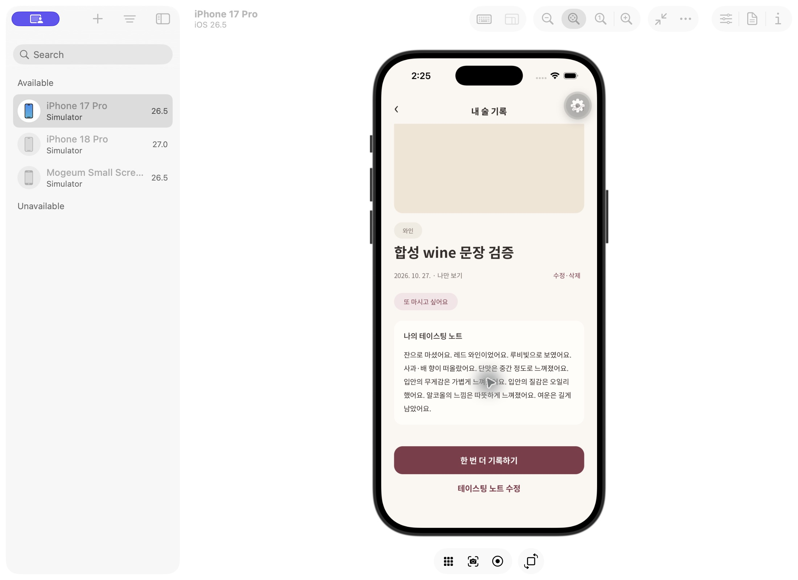

# 자연스러운 심화 노트 · #180

2026-10-27. 4주종 합성 답변에서 질문명:답변 나열 대신 관찰 문장으로 구성한다. 사용자가 직접 적은 문장, 기존 확정 노트, 줄바꿈을 자동 덮어쓰지 않는다. 원래 질문 답변 코드는 유지한다.

## 실제 검증

- 실제 로컬 Supabase Auth 계정 → 4주종 기록 생성 → 심화 문장 저장 RPC → 동일 operation 재시도 → 상세 재조회에서 확정 문장 일치 확인. 이어 직접 편집 글/줄바꿈 저장·재조회 확인. 임시 사용자만 정리했다. `MOGEUM_TEST_SUPABASE_HTTP=1 tsx --test tests/tasting-prose-api.test.ts` 통과.
- iPhone 17 Pro / iOS 26.5 시뮬레이터의 loopback 전용 합성 계정에서 실제 TastingComposer의 와인 미리보기 → 저장 → DB 재조회 → RecordDetailScreen 문단 표시 → 노트 다시 열기를 확인했다. `app/dev/tasting-prose`는 실제 앱 로그인 세션을 사용하지 않으며 관리형 프로젝트 URL을 거부한다.
- 4주종 모두 네이티브 터치를 수행했다는 뜻은 아니다. Android 및 물리 iPhone 재검증은 미실행이며 Figma 전체 픽셀 일치로 주장하지 않는다.

